# Veritabanı Tasarımı (Supabase / PostgreSQL)

Veritabanı **Supabase** (bulutta PostgreSQL). Tüm tablolar `pdks` adlı şemada durur.
İş kuralları (gece işi, düzeltme, görevler ayrılığı, ay kilidi) PostgreSQL fonksiyonları ve trigger'lar
olarak veritabanının içinde çalışır.

## Erişim modeli

- **Giriş:** Supabase Auth. Her kullanıcının `pdks.kullanici` satırı `auth_kullanici_id` sütunuyla
  Supabase Auth kullanıcısına, `calisan_id` sütunuyla kendi çalışan kaydına bağlanır. Rol `kullanici.rol`
  sütunundadır: `amir`, `ik`, `guvenlik`, `yonetici`, `isg` (İSG uzmanı), `admin` (sistem yöneticisi). Oturumdaki kullanıcıyı `pdks.oturum_kullanici_id()`,
  rolünü `pdks.oturum_rolu()` verir. Oturum için hem hesap (`kullanici.aktif`) hem bağlı çalışan (`calisan.aktif`)
  aktif olmalı: işten ayrılan çalışanın hesabı açık kalsa bile oturumu yoktur ve hesap yeniden açılamaz (T-71).
- **Yetki:** Her tabloda RLS (satır düzeyinde güvenlik) açıktır. Politikalar oturumdaki kullanıcının rolüne
  bakar. Örneğin amir yalnızca kendi departmanının sorularını görür, güvenlik yalnızca geçici kart ekranını kullanır.
- **Veri bağlantısı:** Next.js uygulaması supabase-js ile bağlanır. Okuma sorgu oluşturucusuyla, kural içeren
  her yazma işlemi veritabanı fonksiyonu üzerinden RPC ile yapılır (ör. `pdks.duzeltme_uygula`).
- **Gece işi:** pg_cron her gece veritabanı içinde çalıştırır; demoda ekrandaki buton aynı fonksiyonu RPC ile tetikler.

> **RLS** = "bu kullanıcı bu satırı görebilir mi?" sorusunu her sorguda veritabanının kendisinin sorması.
> **RPC** = uygulamanın, veritabanındaki bir fonksiyonu adıyla çağırması.

## Dosyalar

| Dosya | İçerik |
|---|---|
| `supabase/migrations/20261114000100_tablolar.sql` | Şema ve 24 tablo |
| `supabase/migrations/20261114000200_kurallar.sql` | Trigger'lar, fonksiyonlar, görünümler (silinemezlik, ay kilidi) |
| `supabase/migrations/20261114000300_roller_ve_yetkiler.sql` | `pdks_uygulama` ve `pdks_gece_isi` rolleri, yetkiler (20261118030000'de kaldırıldı) |
| `supabase/migrations/20261114000400_varsayilan_ayarlar.sql` | İK ayarlarının varsayılanları, örnek vardiyalar |
| `supabase/migrations/20261115000500_fazla_mesai.sql` | Fazla mesai: yazılı onay, plan, 270 saat / 11 saat sınırları (+2 tablo) |
| `supabase/migrations/20261117010000_kiosk_kaldir.sql` | Şema düzenlemesi: PIN alanları ve ilgili fonksiyonlar |
| `supabase/migrations/20261117020000_gecici_kart.sql` | Geçici kart ve zimmet, `guvenlik` rolü, geçici kart uyarıları, `okutma_sahibi()` |
| `supabase/migrations/20261117030000_kart_paylasimi.sql` | Kart paylaşımı şüphe kuralı (`kart_paylasim_kontrol()`) |
| `supabase/migrations/20261118010000_sema_temizligi.sql` | Tablo açıklamaları ve ayar geçmişi düzenlemesi |
| `supabase/migrations/20261118020000_gorevler_ayriligi.sql` | `kullanici.calisan_id`, "kimse kendi kaydında işlem yapamaz" trigger'ları |
| `supabase/migrations/20261118030000_giris_ve_yetki.sql` | Oturum fonksiyonları, `authenticated` okuma yetkisi, RLS politikaları, görünüm ayarları |
| `supabase/migrations/20261118040000_ayar_al_yetkisi.sql` | `ayar_al()` sahibinin yetkisiyle çalışır, `authenticated` çalıştırabilir (`v_fazla_mesai_yillik` düzeltmesi) |
| `supabase/migrations/20261119010000_ekran_fonksiyonlari.sql` | Ekranların çağırdığı 22 RPC fonksiyonu; ayrıntı: [ekran_fonksiyonlari.md](ekran_fonksiyonlari.md) |
| `supabase/migrations/20261119010000_ekran_fonksiyonlari.sql` | Ekranların yazma işlemleri için RPC fonksiyonları (ayrıntı: `docs/ekran_fonksiyonlari.md`) |
| `supabase/migrations/20261120010000_gece_isi.sql` | Gece işi (`gece_isi_calistir`), demo düğmesi (`gece_isi_tetikle`), pg_cron zamanlaması; üst amiri olmayan amirin kendi sorusu İK'ya gider |
| `supabase/migrations/20261121010000_puantaj.sql` | Ay kilitlenince puantaj yazılır (`normal` + `fark` satırları); günün hesap kuralı tek fonksiyonda (`gun_hesabi`) |
| `supabase/migrations/20261122010000_izin_iptal_ve_departman_ozeti.sql` | İzin iptali (`izin_iptal`, iptal izi) ve yönetici paneli için `v_departman_ozet` |
| `supabase/migrations/20261123010000_puantaj_kurallari.sql` | Tolerans 10/5 dk ve yuvarlama, onaysız fazla mesai havuzu, FM50 / FM100, gece çalışması, saatlik izin, puantaj kodları ve kalemleri (+3 tablo) |
| `supabase/migrations/20261125010000_organizasyon_ve_roller.sql` | `departman.yaka` (mavi / beyaz), `isg` ve `admin` rolleri, admin için `kullanici_ekle`, `kullanici_guncelle`, `ayar_guncelle` |
| `supabase/migrations/20261126010000_isg.sql` | Bölge (`bolge`, `okuyucu.bolge_id`, `bolge_yetkisi`), İSG belgeleri (`isg_belge`, `v_isg_durum`), İSG ve bölge uyarıları (+3 tablo) |
| `supabase/migrations/20261127010000_bolge_yetkisi_izi.sql` | Bölge yetkisinin verilme / kaldırılma izi `bolge_yetkisi_gecmisi` (+1 tablo) |
| `supabase/migrations/20261127020000_erp_aktarim.sql` | ERP aktarım görünümü `v_puantaj_aktarim` (kilitli ayın puantaj kodları) |
| `supabase/migrations/20261128010000_dosya_yukle_duzeltmesi.sql` | `dosya_yukle` düzeltmesi: dosyanın SHA-256 özeti (`p_dosya_ozeti`), yalnızca yazılan okutmaları sayan `satir_sayisi`, satır numaralı sunucu denetimi |
| `supabase/migrations/20261129010000_esnek_kanit.sql` | Esnek mesaide PDKS girişi eksikse giriş = kanıt + yürüme payı (amire soru gitmez) |
| `supabase/migrations/20261129020000_zimmet_cakisma_mesaji.sql` | Zimmet çakışma hatası çakışan zimmeti söyler; Türkçe ek yardımcıları `yonelme_eki`, `saat_eki` |
| `supabase/migrations/20261204010000_dosya_yukle_where.sql` | `dosya_yukle`'deki geçici tablo güncellemesine `where zaman_metni is not null` eklendi; ekrandan (HTTP) yükleme `safeupdate`'e takılmaz (T-31). Fonksiyonun geri kalanı ve yetkileri aynı |
| `supabase/migrations/20261203010000_plan_onayi.sql` | Gece işi onay bekleyen / reddedilmiş planı kullanmaz; onay günü hemen düzeltir ya da işletir (kilitli ayda fark satırı); reddedilmiş ya da onay bekleyen planın işlenmemiş günü kilidi zorla bile durdurur; kimse kendi kaydının planını onaylayamaz |
| `supabase/migrations/20261202010000_durum_duzeltmesi.sql` | Gün devamsız / izinli / raporlu / tatil / vardiya yok yapılınca eski dakikalar temizlenir ve hesap kapanır (puantaja dakika gelmez, gün "bekleyen" sayılmaz) |
| `supabase/migrations/20261201020000_kilit_ozeti.sql` | Onay bekleyen geriye dönük plan kilidi durdurur (zorla geçilir); `ay_kilitle` sonuç döner: zorla geçilen kalemler ve puantaja kodsuz giren gün sayısı |
| `supabase/migrations/20261201010000_ay_kilidi_ve_aninda_hesap.sql` | Gün hesabı tek yerde (`gun_hesapla`); soru cevabı, İK kararı ve kayıt düzeltmesi günü hemen hesaplar; ay kilidi önce hesaplar, işlenmemiş planlı gün varken kilitlemez; İK, İK'ya eskale edilen soruyu kapatabilir |
| `supabase/migrations/20261130010000_ise_giris_cikis.sql` | İşe giriş ve işten çıkış (`calisan_ekle`, `isten_cikis_gir`; yalnızca İK). Gece işi çalışanı `aktif` alanıyla değil işe giriş / işten çıkış tarihiyle süzer |
| `supabase/migrations/20261124010000_vardiya_kurallari.sql` | Yeni vardiyalar (08-16, 16-24, 00-08, 08:30-18:00, esnek), esnek mesai ve `v_esnek_mesai`, otomatik vardiya tanıma (öneri amir onayıyla uygulanır), mola (m.68); vardiya düzeltmesi planlı saatleri de günceller |
| `supabase/tests/durum_duzeltmesi_testi.sql` | Durum düzeltmesi: dakika temizliği, bekleyen gün, tekrar "tamam", kilitli puantaj için 11 test |
| `supabase/tests/kurallar_testi.sql` | 27 kural testi (her şeyi geri alır, iz bırakmaz) |
| `supabase/tests/izin_ve_ozet_testi.sql` | İzin iptali ve departman özeti için 15 test |
| `supabase/tests/puantaj_testi.sql` | Puantaj: kilit, normal ve fark satırları için 16 test |
| `supabase/tests/puantaj_kurallari_testi.sql` | Tolerans, havuz, FM50 / FM100, gece çalışması, saatlik izin, kodlar ve kalemler için 68 test |
| `supabase/tests/vardiya_kurallari_testi.sql` | Yeni vardiyalar, mola, esnek mesai (eksik girişte kanıt saati dahil), otomatik vardiya tanıma ve vardiya düzeltmesi için 28 test |
| `supabase/tests/organizasyon_roller_testi.sql` | Yaka, `isg` / `admin` rolleri, admin fonksiyonları, admin'in karar verememesi ve rol bazında görünürlük için 35 test |
| `supabase/tests/isg_testi.sql` | Bölge yetkisi ve izi, İSG belgeleri, uyarılar ve İSG yetkileri için 30 test |
| `supabase/tests/erp_aktarim_testi.sql` | ERP aktarımı: yalnızca kilitli ay, kalemlerle tutarlılık, fark satırı, yetkiler için 9 test |
| `supabase/tests/dosya_yukle_testi.sql` | Dosya yükleme: özet, satır sayısı, çakışan okutmalar, hatalı girdiler, eski çağrı biçimi için 24 test |
| `supabase/tests/gece_isi_testi.sql` | Gece işi: 23 mekanik test (her zaman) + örnek veri yüklüyse S1–S23 senaryoları (26 test) |
| `supabase/tests/fazla_mesai_testi.sql` | Fazla mesai kural testleri |
| `supabase/tests/gecici_kart_ve_paylasim_testi.sql` | Geçici kart (çakışma mesajı dahil), kart paylaşımı ve fonksiyon yetkileri için 39 test |
| `supabase/tests/gorevler_ayriligi_testi.sql` | Görevler ayrılığı için 20 test |
| `supabase/tests/giris_ve_yetki_testi.sql` | Rol bazında görünürlük (RLS) ve görünüm fonksiyonu yetkileri için 29 test |
| `supabase/tests/ekran_fonksiyonlari_testi.sql` | Ekran fonksiyonlarının rol, departman ve görevler ayrılığı kontrolleri için 42 test |
| `supabase/seed.sql` | Örnek (sahte) veri: Kasım 2026, 19 departman, 76 çalışan, 23 senaryo. Ayrıntı: `docs/ornek_veri.md` |
| `scripts/sentetik_veri.mjs` | Sentetik veri seti üreticisi: 180 çalışan, Ekim 2026, gerçeğe benzer sicil / kart / hata oranları. Ayrıntı: `docs/sentetik_veri.md` |
| `supabase/tests/ornek_veri_testi.sql` | Örnek verinin büyüklüğü ve senaryoları için 37 test (seed'den sonra çalışır) |
| `supabase/tests/sema_temizligi_testi.sql` | Şemada kullanılmayan özelliklere ait kalıntı olmadığını doğrulayan 8 test |
| `supabase/tests/where_siz_guncelleme_testi.sql` | `pdks` fonksiyonlarında WHERE'siz `UPDATE` / `DELETE` taraması (tarayıcının kendi sınaması dahil) için 9 test |
| `supabase/migrations/20261205010000_istanbul_tarihi.sql` | `pdks.bugun()`: İstanbul'a göre bugün; şemadaki bütün `current_date`'ler buna çevrildi (T-45). Yazılı onayın geri alınması her zaman kaydedilir: ileri tarihli planlar sistemce iptal, geçmiş / kilitli aydakiler korunur (T-59) |
| `supabase/tests/istanbul_tarihi_testi.sql` | Aynı işlemler UTC−12 ve UTC+14 oturumla: plan, fazla mesai iptali ve onay geri alma, gece işi, İSG durumu, kart tarihi için 24 test (gece işi sınırının 3 testi yalnızca örnek veri yokken çalışır) |
| `supabase/migrations/20261206010000_rls_hizi.sql` | `gun_kaydi`, `calisan`, `amir_sorusu`, `itiraz`, `departman`, `vardiya_tanim`, `vardiya_plani`, `kanit_kaydi`, `ham_okutma` okuma politikaları `(select pdks.f())` kalıbında; amirin çalışanları için `pdks.oturum_calisanlari()` (T-104). Kim neyi görür değişmedi |
| `supabase/tests/rls_hizi_testi.sql` | RLS hızı: politika yapısı, 8 oturumda görünen satırların eski politikalarla eşdeğerliği, Montaj amirinin Departmanlar ve Vardiya planı okumaları 500 ms altında (örnek veriyle) için 28 test |
| `supabase/migrations/20261207010000_ay_kilidi_zamani.sql` | `ay_kilitle`: ayın son günü İstanbul tarihiyle bugünden önce değilse ret, zorla da (T-89). `pdks.bugun()`: testler için `pdks.test_bugun` ayarı, yalnızca `session_user = 'postgres'` iken |
| `supabase/tests/ay_kilidi_zamani_testi.sql` | Ay kilidi zamanı: içinde bulunulan, gelecek ve iki ay sonraki ay ret; bitmiş ay kabul; ayın son günü sınırı; tarih ayarının yalnızca doğrudan bağlantıda geçerliliği için 10 test |
| `supabase/migrations/20261208010000_kullanici_cift_kayit.sql` | `kullanici` tablosundaki iki çift kayıt kaldırıldı (T-105). `izinli_mi` kolonu silindi; amirin izni `izin` tablosundan okunur (`kullanici_izinli_mi`), izinli amirin sorusu vekile gider. `ad_soyad` artık çalışan kaydından yazılır (trigger `kullanici_ad_soyad`, `calisan_adi_degisti`); `kullanici_ekle` ad soyad almaz |
| `supabase/tests/kullanici_cift_kayit_testi.sql` | İzin tablosuna göre soru yönlendirmesi (izin, rapor, iptal, izin bitişi, vekilsiz departman), çalışandan gelen ad soyad ve yeni `kullanici_ekle` için 20 test |
| `supabase/migrations/20261209010000_kodsuz_gun.sql` | `ay_kilitle`: puantaja kodsuz girecek gün varsa zorlamadan ret (sicil, gün, neden; en çok 10 gün); zorla kilitte "Zorla geçilenler" ve özette `kodsuz_gun_listesi` (T-90, T-101) |
| `supabase/tests/kodsuz_gun_testi.sql` | Kodsuz gün: zorlamadan ret ve mesajdaki gün listesi (10 gün sınırı), zorla kilit özeti, kodsuz gün yokken kilit için 8 test |
| `supabase/migrations/20261210010000_ikinci_eskale.sql` | `amir_sorusu.ik_eskale_zamani`; `gece_isi_eskale` ikinci kademe (üst amir de cevaplamazsa `ik_karari_bekliyor`); `soru_ik_karari` her açık soruyu kabul eder (T-39) |
| `supabase/tests/soru_eskale_testi.sql` | Soru eskalasyonu: amir → üst amir → İK, süre sınırları, bir gecede bir kademe, üst amiri olmayan amir, İK'nın her açık soruya kararı ve gün hesabı için 17 test |
| `supabase/migrations/20261211010000_cikmis_hesap.sql` | `kullanici_guncelle` işten ayrılmış çalışanın hesabını açmaz; `oturum_kullanici_id` bağlı çalışanın aktif olmasını şart koşar; açık kalmış hesaplar kapatılır (T-71) |
| `supabase/tests/cikmis_hesap_testi.sql` | Çıkmış çalışanın hesabı: yeniden açma reddi, elle açık hesapla oturum ve işlem yok, çalışmaya devam edenin hesabı için 8 test |
| `supabase/migrations/20261212010000_ayar_sinirlari.sql` | `ayar.en_az` / `en_cok` / `puantaji_etkiler`; `ayar_guncelle(text, text)` aralığı, mola sıralamasını ve tam sayıyı denetler; `puantaj_ayari_degisti` uyarısı (T-74) |
| `supabase/tests/ayar_sinirlari_testi.sql` | Ayar sınırları: her ayarda aralık dışı ret ve sınır değer kabul, yasal sınırlar, mola sıralaması, geçersiz giriş, İK'ya uyarı için 68 test |
| `supabase/migrations/20261213010000_yukleyen.sql` | `aktarim.yukleyen_id`; `dosya_yukle` yükleyeni oturumdan yazar, kendi okutmasını içeren dosyada `kendi_okutmasi_yuklendi` uyarısı yazar; yükleyen bu uyarıyı görmez (`uyari` okuma politikası, `oturum_calisan_id`) (T-13) |
| `supabase/tests/yukleyen_testi.sql` | Yükleyen: kayıt, asıl ve geçici kart, kapı dosyası, yeniden gelen okutma, uyarıyı kim görür / kapatır için 21 test |
| `supabase/migrations/20261214010000_rapor_gizliligi.sql` | `duzeltme.amir_okur` kaldırıldı; `v_duzeltme_amir` görünümü (kendi çalışanları, gizli gerekçe, "raporlu" → "izinli") (T-12) |
| `supabase/tests/rapor_gizliligi_testi.sql` | Rapor gizliliği: tablo amire kapalı, görünümün gizlediği ve gösterdiği alanlar, departman sınırı, yetkiler için 19 test |
| `supabase/migrations/20261215010000_ik_karar_gerekcesi.sql` | `amir_sorusu.ik_karari`; `soru_ik_karari` gerekçeyi yalnızca `duzeltme`'ye yazar; `v_duzeltme_amir` İK soru kararında da gerekçeyi gizler; eski kayıtlar temizlenir (T-106) |
| `supabase/tests/ik_karar_gerekcesi_testi.sql` | İK karar gerekçesi: amirin okuyabildiği her yer taranır, sonuç ve amirin kendi notu görünür, İK / yönetici gerekçeyi görür için 13 test |
| `supabase/migrations/20261216010000_ekran_metinleri.sql` | `ayar.ad` / `kategori` / `sira`; `sure_metni`, `ayar_degeri_metni`, `soru_cevabi_adi`; 21 fonksiyonda yalnızca metin |
| `supabase/tests/ekran_metinleri_testi.sql` | Ekran metinleri: ayar ad ve açıklamaları, süre metni, cevap adları, eski ifadeler için 8 test |
| `supabase/migrations/20261217010000_oturum_yardimcilari.sql` | `oturum_rolu`, `oturum_calisan_id`, `oturum_departmanlari`, `oturum_calisanlari`, `amirin_calisani_mi` oturumu kendi içlerinde de `(select pdks.f())` ile bir kez sorar (T-108). Sonuçları ve yetkileri aynı |
| `supabase/migrations/20261218010000_cakisan_izin.sql` | `izin_gir` kesişen geçerli izni, `saatlik_izin_gir` tam gün izinli günü reddeder (T-47) |
| `supabase/tests/cakisan_izin_testi.sql` | Çakışan izin: kesişme ve sınır günleri, iptal sonrası, başka İK, saatlik izin için 18 test |
| `supabase/migrations/20261219010000_cikis_okutma.sql` | `isten_cikis_gir` çıkış gününden sonraki ham okutmayı da denetler (`cikistan_sonraki_okutma`) (T-65) |
| `supabase/tests/cikis_okutma_testi.sql` | İşten çıkışta okutma denetimi: işlenmemiş / plansız gün, gece vardiyası penceresi, geçici kart, iptal kart, saat dilimi için 19 test |
| `supabase/migrations/20261220010000_havuz_yazili_onay.sql` | `fazla_mesai_inceleme.yazili_onaysiz`; yazılı onay yokken onaylanan havuz kaydı işaretlenir, `yazili_onay_eksik` uyarısı yazılır (T-56) |
| `supabase/tests/havuz_yazili_onay_testi.sql` | Yazılı onaysız havuz onayı: dakika, işaret, uyarı, imza tarihi, sonradan gelen belge, ret, kilitli ay için 15 test |
| `supabase/migrations/20261221010000_yillik_fazla_mesai.sql` | `v_fm_yillik_gun`, `fm_yillik_toplam`; `v_fazla_mesai_yillik` aynı hesabı gösterir (T-62); plan bununla reddedilir, aşan havuz onayı `fazla_mesai_inceleme.yillik_sinir_asildi` ile işaretlenir (T-57) |
| `supabase/tests/yillik_fazla_mesai_testi.sql` | Yıllık sınır: plan reddi, tatil, çift sayım, havuz işareti, uyarı, kilitli ay, yıllık görünüm (T-62) için 22 test |
| `supabase/migrations/20261222010000_arife.sql` | Arifede çalışma 13:00'te biter, sonrası FM100 (`arife_siniri`, `vardiya_ham_araligi`); 2026–2027 arifeleri (T-28) |
| `supabase/tests/arife_testi.sql` | Arife: erken çıkış, FM100, yazılı onaysız, gece vardiyası, gelmeyen, kod, esnek, yıllık toplam, takvim için 28 test |
| `supabase/migrations/20261223010000_rol_onayi.sql` | İK / admin rolü iki adımlı (`rol_onerisi`, `rol_onerisi_karar`); hesap değişikliklerinin izi `kullanici_gecmisi` (T-72, T-33; +2 tablo) |
| `supabase/tests/rol_onayi_testi.sql` | Rol onayı: yeni hesap, yükseltme, pasif hesabı açma, görevler ayrılığı, iptal, geçmiş, yetkiler için 38 test |
| `supabase/migrations/20261224010000_plansiz_gun.sql` | Planı olmayan günün okutması: `plansiz_gun_calismasi` uyarısı (İK, amir) ve havuz kaydı (`gece_isi_plansiz`) (T-79) |
| `supabase/tests/plansiz_gun_testi.sql` | Plansız gün: uyarı, havuz, komşu vardiya, onay / ret, FM50 / FM100, geriye dönük plan, kilit, görünürlük için 40 test |
| `supabase/migrations/20261225010000_gecmis_izin.sql` | İşlenmiş güne girilen izin günü düzeltir ve soruyu kapatır, iptal geri alır; İK düzeltmesi soruyu kapatır; izinli güne devamsız denemez (T-46, T-40) |
| `supabase/tests/gecmis_izin_testi.sql` | Geçmiş güne izin, okutmalı gün, devamsız denetimi, izin iptali, İK düzeltmesi ve soru, kilitli ay için 29 test |
| `supabase/migrations/20261226010000_gunluk_sinir.sql` | Havuz onayında günlük 11 saat: onaylanan günün brüt süresi (çalışma + mola) sınırı aşarsa `fazla_mesai_inceleme.gunluk_sinir_asildi` işaretlenir, İK'ya uyarı yazılır; süre puantaja girer (T-58) |
| `supabase/tests/gunluk_sinir_testi.sql` | Havuz onayında günlük 11 saat (T-58): puantaja giriş, işaret, uyarı, 660 / 661 dk sınırı, plan yoluyla aynı ölçü, ret, Pazar, görünürlük için 13 test |
| `supabase/migrations/20261227010000_plan_onayi_hesap.sql` | İşlenmiş güne gelen fazla mesai planı onayı günü hemen yeniden hesaplar; karşılanan havuz kaydı kapanır, kalan bekler; kilitli aya ve havuzdan onaylanmış güne plan onayı verilmez (T-61) |
| `supabase/tests/plan_onayi_hesap_testi.sql` | Sonradan plan onayı (T-61): hemen hesap, havuzun kapanması / kalan süre, iki kez sayılmama, ret, kilitli ay için 13 test |
| `supabase/migrations/20261228010000_gecmis_plan_talebi.sql` | Geçmiş güne fazla mesai planı talebi reddedilir; geçmiş günün süresi havuzdan gelir (T-76) |
| `supabase/tests/gecmis_plan_talebi_testi.sql` | Geçmiş güne talep (T-76): amir / İK reddi, bugün ve yarın serbest, zamanında girilen talebin sonradan onayı için 7 test |
| `supabase/migrations/20261229010000_plan_gecmisi.sql` | Vardiya planının eski hâlleri `vardiya_plani_gecmisi` (+1 tablo); geriye dönük değişiklik reddedilince son geçerli plan geri gelir (T-49) |
| `supabase/tests/plan_gecmisi_testi.sql` | Plan geçmişi (T-49): ret sonrası geri yükleme ve gün işleme, işlenmiş gün, iki kez değişiklik, plansız gün, onay, silinmezlik, görünürlük için 18 test |
| `supabase/migrations/20261230010000_saatlik_izin_iptal.sql` | Yanlış saatlik izin `saatlik_izin_iptal` ile iptal edilir (kim / ne zaman / neden); iptal edilen izin hesaba girmez, gün yeniden hesaplanır (T-50) |
| `supabase/tests/saatlik_izin_iptal_testi.sql` | Saatlik izin iptali (T-50): yeniden hesap, iz, yetki, görevler ayrılığı, kilitli ay, gece işi, silinmezlik, amir görünümü için 25 test |
| `supabase/migrations/20261231010000_plansiz_izin_gunu.sql` | Planı olmayan izin günü puantajda izin kodunu alır, HT değil (`plansiz_izin_gunleri`, `gun_kodlari_hesapla`, `v_puantaj_canli`); kilitli ayın böyle gününe izin girişi / iptali reddedilir; `izin` okuma politikası sorgu başına bir kez (T-94) |
| `supabase/tests/plansiz_izin_gunu_testi.sql` | Planı olmayan izin günü (T-94): kodlar, Cumartesi ayarı, rapor / arife / bayram, iptal, işe giriş, kilit, RLS altında aynı sonuç, hız yapıları, kilitli ayda ret için 35 test |
| `supabase/migrations/20261231020000_ik_karari_cevaplayan.sql` | İK kararı amirin cevabını silmez: `amir_sorusu.ik_karar_veren_id` / `ik_karar_zamani`; işten çıkış soruyu kapanış sütunlarıyla kapatır; "yalnızca İK kapatır" ve görevler ayrılığı yeni sütuna bakar; eski kayıtlar taşınır (T-32) |
| `supabase/tests/ik_karari_cevaplayan_testi.sql` | İK kararı ve cevaplayan (T-32): gelmedi / bilmiyorum / cevapsız soru, karar zamanı, görevler ayrılığı, yalnızca İK kapatır, check, işten çıkış için 17 test |
| `supabase/migrations/20261231030000_eksik_saat_reddi.sql` | Amirin cevabı ya da İK'nın "geldi" kararı uygulanınca günde giriş ve çıkış kalmayacaksa reddedilir (`cevap_saatleri_denetle`); kilitli ayda fark satırındaki saat de sayılır (T-41) |
| `supabase/tests/eksik_saat_reddi_testi.sql` | Tek saatli cevap (T-41): giriş yok / kanıt vardiya sonrası / hiç kayıt yok / çıkış yok, saat doğru ve kart unuttu, İK geldi ve devamsız, kilitli ay için 15 test |
| `supabase/migrations/20261231040000_hesapsiz_gun.sql` | Hesabı tamamlanmamış gün canlı puantajda ve yönetici panelinde çalışılan değil bekleyen sayılır; satır ile kod listesi aynı sayar (T-91) |
| `supabase/tests/hesapsiz_gun_testi.sql` | Hesabı tamamlanmamış gün (T-91): canlı puantaj, kod listesi, panel, hesap sonrası, zorla kilitte satır = kalem için 8 test |
| `supabase/migrations/20261231050000_zorla_kilit_izi.sql` | Zorla kilitte gerekçe zorunlu (`ay_kilitle` 4. parametre `p_gerekce`); her kilidin değiştirilemez izi `donem_kilit_izi` (+1 tablo; yalnızca İK / yönetici okur) (T-92) |
| `supabase/tests/zorla_kilit_izi_testi.sql` | Zorla kilit izi (T-92): gerekçe zorunlu, iz ve özet listeleri, değiştirilemezlik, check, amir göremez, normal kilit ve 3 parametreli çağrı için 18 test |
| `supabase/migrations/20261231060000_kilitli_vardiya.sql` | Kilitli ayın vardiyası değişmez: kilitli güne vardiya düzeltmesi reddedilir (plan onayı, kayıt düzeltmesi, amir cevabı); trigger `duzeltme_kilitli_vardiya` (T-93) |
| `supabase/tests/kilitli_vardiya_testi.sql` | Kilitli ayda vardiya (T-93): plan onayı reddi, bekleyen planın reddi, kayıt düzeltmesi, saat düzeltmesi fark olur, açık ayda havuz için 11 test |
| `supabase/migrations/20261231070000_reddedilen_tatil.sql` | Reddedilen ya da karar bekleyen tatil çalışması (0 dk) FM100 değil HT / RT kodlanır, çalışılan gün sayılmaz; tek kural `sayilmayan_tatil_calismasi` (kod listesi, gün katkısı, canlı puantaj, departman özeti) (T-102) |
| `supabase/migrations/20261231080000_kilitte_fm_talebi.sql` | Ay kilidi o ayın karar bekleyen fazla mesai taleplerini kapatır (kişisiz iptal, "Dönem kilitlendi"); mesajda, sonuçta (`kapatilan_fm_talebi`) ve kilit izinde görünür; kilidi durdurmaz (T-63) |
| `supabase/tests/kilitte_fm_talebi_testi.sql` | Kilitte bekleyen FM talebi (T-63): zorlamasız ve zorla kilitte kapanma, başarısız kilitte geri alınma, mesaj ve iz, karara bağlanmış / başka aydaki talep, havuzdan fark, kişisiz iptalin kilit dışında reddi için 15 test |
| `supabase/migrations/20261231090000_kilitli_ay_cikis.sql` | İşten çıkış kilitli ayın planına ve iznine dokunmaz; çıkış kilitli aya düşerse sonuçta ve `cikis_kilitli_ay` uyarısında söylenir; kilitli ayın vardiya planı silinemez (tetikleyici `vardiya_plani_kilitli_silme`) (T-67) |
| `supabase/tests/kilitli_ay_cikis_testi.sql` | Kilitli aya düşen çıkış (T-67): kilitli ayın planı ve izni kalır, açık ayınki silinir / iptal, fark satırı, sonuç ve uyarı, açık ayda eski davranış, doğrudan silme engeli için 9 test |
| `supabase/migrations/20261231100000_gecersiz_amir.sql` | Soru cevaplayamayan amir (pasif hesap, rol değişikliği, işten çıkış): sorular vekile / üst amire / İK'ya açılır ve devredilir, eskale pasif üst amire gitmez, İK'ya `amirsiz_departman` uyarısı (T-70) |
| `supabase/tests/gecersiz_amir_testi.sql` | Soru cevaplayamayan amir (T-70): devir, uyarı metni, pasif / rol / vekil / üst amir / İK sırası, devralanın cevabı, eskale, geri dönen amir, vekil uyarısı için 14 test |
| `supabase/migrations/20261231110000_kart_tanimlayan.sql` | Kartı kimin tanımladığı (`kart.tanimlayan_id`, değiştirilemez); görevler ayrılığı kart tanımlamayı da kapsar: kimse kendine kart tanımlayamaz (T-82) |
| `supabase/tests/kart_tanimlayan_testi.sql` | Kart tanımlayan (T-82): yazılır, kendine tanımlama reddi, başka İK tanımlar, değiştirilemez, doğrudan ekleme reddi için 8 test |
| `supabase/migrations/20261231120000_dosya_tarihi.sql` | Dosyanın günü ve satır tarihleri: satır dosyanın günü ya da ertesi gün olmalı (önceden gelmiş okutmanın tekrarı hariç), ileri tarih ve kilitli ay reddedilir; gece işi bugünden ileri günü işlemez; hata mesajı girdiyi kısaltır (T-17, T-18, T-21) |
| `supabase/tests/dosya_tarihi_testi.sql` | Dosya tarihi (T-17, T-18, T-21): yanlış günün dosyası, gece vardiyası ve saat dilimi, çakışan dışa aktarım, ileri tarihli dosya / satır / gece işi, kilitli ay, uzun girdi için 13 test |
| `supabase/migrations/20261231130000_paylasim_karari.sql` | Kart paylaşımı şüphesinde İK kararı: uyarı günleri / saati / okuyucuyu yazar (`uyari.ayrinti`), `kart_paylasim_karar` (yalnızca İK, gerekçeli, bir kez, değiştirilemez); "var" kararı gün kaydına dokunmaz (T-81) |
| `supabase/tests/paylasim_karari_testi.sql` | Kart paylaşımı kararı (T-81): mesaj ve ayrıntı, karar bekleyen uyarının güncellenmesi, yetki, görevler ayrılığı, gerekçe, tür, karar sonucu, gün kaydına dokunmama, değiştirilemezlik için 18 test |
| `supabase/migrations/20261231140000_calisan_kart_kurallari.sql` | Plan, izin ve saatlik izin yalnızca çalışma tarihleri içinde (`calisan_tarih_denetle`); kart ayrılmış çalışana verilmez, geçici kart yalnızca çalışana; kart numarası kimde söylenir; iptal nedeni zorunlu; işe giriş aralığı ve büyük/küçük harfe duyarsız sicil (T-68, T-75, T-86) |
| `supabase/tests/calisan_kart_kurallari_testi.sql` | Çalışma tarihi, kart, geçici kart, iptal nedeni ve çalışan ekleme kuralları (T-68, T-75, T-86) için 28 test |
| `supabase/migrations/20261231150000_isg_belge_sirasi.sql` | İSG'de geçerli belge en geç biten belge; bitiş bugün ± 10 yıl; `v_isg_durum.izleniyor` (T-87) |
| `supabase/tests/isg_belge_sirasi_testi.sql` | İSG belge sırası, tarih aralığı ve izlenen yaka (T-87) için 5 test |
| `supabase/migrations/20261231160000_itiraz_kurallari.sql` | Çalışma tarihi dışına ve aynı güne ikinci açık itiraz yok; çıkış sonrası itirazlar kapanır; İK kendi itirazını inceleyemez; talep eden kendi FM talebine karar veremez (T-69, T-51, T-15, T-16) |
| `supabase/tests/itiraz_kurallari_testi.sql` | İtiraz ve FM kararı kuralları (T-15, T-16, T-51, T-69) için 9 test |
| `supabase/migrations/20261231180000_kalan_kurallar.sql` | `v_izin_amir` açıklaması (T-07); düzeltmeye yalnızca aynı günün, reddedilmemiş itirazı bağlanır (T-34); geçici kart zimmetinde ileri tarihli veriliş / iade ve verilişten önce iade yok (T-84) |
| `supabase/tests/kalan_kurallar_testi.sql` | Görünüm açıklaması, düzeltme–itiraz bağı ve zimmet zamanları (T-07, T-34, T-84) için 9 test |
| `supabase/migrations/20261231190000_puantaj_kalanlari.sql` | Çıkışta son okutma tutulur (T-29); yalnızca kodu değişen fark da yazılır (T-95); yılda tek geçerli yazılı onay (T-60); security definer fonksiyonlarda `pg_temp` sonda (T-03); yeni fonksiyon kapalı doğar (T-08) |
| `supabase/tests/mukerrer_cikis_testi.sql` | Mükerrer çıkış: son okutma, zincir, eski işaretli çift (T-29) için 5 test |
| `supabase/tests/kod_farki_testi.sql` | Yalnızca kodu değişen fark satırı ve kalemi (T-95) için 4 test |
| `supabase/tests/yazili_onay_yenileme_testi.sql` | Yazılı onayın aynı yıl yeniden verilmesi (T-60) için 5 test |
| `supabase/migrations/20261231200000_kilit_on_kontrol.sql` | Ay kilidi ön kontrolü `ay_kilit_on_kontrol` (T-96); kilit özetinde düzeltmesiz kabul edilmiş itiraz (T-52); izinli günde okutma uyarısı (T-54); geçici kart kayıp / iptal / bulundu `gecici_kart_durum` ve kayıp kart okutma uyarısı (T-85) |
| `supabase/tests/kilit_on_kontrol_testi.sql` | Ön kontrol engelleri ve kilit özeti (T-96, T-52) için 9 test |
| `supabase/tests/izinli_gun_okutma_testi.sql` | İzinli / raporlu günde okutma uyarısı (T-54) için 5 test |
| `supabase/tests/gecici_kart_kayip_testi.sql` | Geçici kartın kayıp / bulundu / iptal durumu, zimmet kapanışı, kayıp kart okutma uyarısı (T-85) için 11 test |
| `supabase/migrations/20261231210000_aleyhe_iz.sql` | Amirin geç kalma / erken çıkış doğuran saati "çalışan aleyhine" işaretlenir (T-44); itirazı incelemeye alan ve arızaya karar veren / zamanı (T-35) |
| `supabase/tests/aleyhe_iz_testi.sql` | Amirin aleyhe saati (tolerans, gece vardiyası, saatlik izin, esnek mesai) ve itiraz / arıza karar izi (T-44, T-35) için 15 test |
| `supabase/migrations/20261231220000_yabanci_anahtar_index.sql` | Sık sorgulanan yabancı anahtarlara 5 index: dosya yükleme (`aktarim_id`), Sorular ekranı (`duzeltme.soru_id`), itiraz bağı (`duzeltme.itiraz_id`), döküm (`duzeltme.calisan_id, is_gunu`) (T-02) |
| `supabase/tests/yabanci_anahtar_index_testi.sql` | Ölçülen yolların index kullandığı (T-02) için 6 test |
| `supabase/tests/reddedilen_tatil_testi.sql` | Reddedilen tatil çalışması (T-102): bekleyen / reddedilen / onaylanan Pazar, reddedilen bayram, normal gün, panel, kilitli puantajda satır = kalem, kilitten sonra onay için 15 test |

> **Migration** = veritabanını adım adım kuran, sırayla çalıştırılan SQL dosyası.
> **Trigger** = bir tabloya ekleme/değiştirme/silme yapılırken kendiliğinden çalışan kontrol.

## Temel kurallar ve veritabanı bunu nasıl sağlıyor?

1. **Ham kayda dokunulmaz.** `ham_okutma`, `kanit_kaydi`, `aktarim`, `okutma_isareti` tablolarında
   uygulamanın UPDATE/DELETE yetkisi yok. Yetkisi olan biri (ör. `postgres`) denese bile trigger engeller.
   Mükerrer okutma (sorun 3) silinmez, `okutma_isareti` tablosunda "mukerrer" diye işaretlenir.
2. **Her düzeltme silinemez izle tutulur (sorun 12).** `duzeltme` tablosu: kim (`kaynak`, `yapan_id`),
   ne zaman (`yapilma_zamani`), `eski_deger`, `yeni_deger`, `gerekce` ve dayanağı (kanıt, izin, arıza,
   soru ya da itiraz). Bu tabloda UPDATE, DELETE, TRUNCATE hem yetkiyle hem trigger'la kapalı.
3. **Uygulamadan izsiz değişiklik imkânsız.** `gun_kaydi` tablosunda giriş, çıkış, vardiya ya da "devamsız"
   değişecekse aynı işlemde yazılmış, değeri birebir tutan bir `duzeltme` satırı olmalı. Bunu
   `pdks.duzeltme_uygula(...)` fonksiyonu yapar; bu alanlarda doğrudan UPDATE hata verir. Diğer durum
   geçişlerini ve dakikaları yalnızca hesap fonksiyonları ve `duzeltme_uygula` yazar; burada koruma yetkidir:
   uygulama rollerinin tabloya yazma yetkisi yoktur, veritabanı sahibi izsiz değiştirebilir (T-01, bilinen sınırlılık).
4. **Gece işi yalnızca kanıtla düzeltir.** `kaynak = 'gece_isi'` olan düzeltmede kanıt kaydı ya da izin zorunlu.
5. **Çalışan aleyhine kararı İK verir.** "devamsız" kararı, itirazın reddi ve ayın kilitlenmesi yalnızca
   İK rolüyle olur. Amir "gelmedi" derse soru kapanmaz, `ik_karari_bekliyor` durumuna geçer.
   Sistem en fazla `devamsiz_suphesi` der. İK'nın kararı amirin cevabını silmez: kim ne dedi
   (`cevaplayan_id`, `cevap`) ve kim karar verdi (`ik_karar_veren_id`, `ik_karar_zamani`) ayrı tutulur (T-32).
   Amirin cevabı ya da İK'nın "geldi" kararı günü yarım bırakamaz: uygulanınca günde giriş ve çıkış
   olmalı, yoksa cevap reddedilir ve soru açık kalır (T-41).
   Amirin yazdığı saat geç kalma ya da erken çıkış doğuruyorsa düzeltme "çalışan aleyhine" işaretlenir
   (karar değil, iz; İK süzebilir, dökümde görünür). Ölçü günün hesabıdır: tolerans, esnek mesai ve saatlik izin sayılır (T-44).
6. **Ay sonu kilidi (sorun 11).** Ay, son günü (İstanbul tarihiyle) geçmeden kilitlenemez; zorla da (T-89).
   Puantaja kodsuz girecek gün (karara bağlanmamış gün) varsa ay zorlamadan kilitlenmez; hata günleri
   adıyla söyler. Zorla kilitte bu günler özetin `kodsuz_gun_listesi` alanında kalır (T-90).
   Zorla kilitte gerekçe zorunludur; her kilit (zorla mı, gerekçe, geçilen açık soru / itiraz / fazla mesai /
   plan listeleri) değiştirilemez `donem_kilit_izi`'ne yazılır, yalnızca İK ve yönetici okur (T-92).
   Kilitli ayın kayıtları değişmez ve kilit geri açılamaz. Kilitten sonra
   gelen düzeltme sonraki açık aya `fark_satiri = true` olarak yazılır. Puantaj (`puantaj_satiri`)
   yalnızca kilitli aya yazılır ve sonra değiştirilemez. Kilit önce ayın hesabı bekleyen günlerini hesaplar;
   gece işinden geçmemiş planlı gün varken (zorla bile) kilitlemez, çünkü kilitten sonra o güne gün kaydı açılamaz.
   Açık soru / itiraz, onaysız fazla mesai ve İK onayı bekleyen geriye dönük plan zorla geçilebilir; kilit sonucu
   bunları ve puantaja kodsuz giren gün sayısını döner.
7. **Puantaj gün ve dakika olarak tutulur.**
8. **Görevler ayrılığı: kimse kendi kaydında işlem yapamaz.** Her kullanıcı `kullanici.calisan_id` ile kendi
   çalışan kaydına bağlıdır. İK kendi gününü düzeltemez, kendi itirazına karar veremez, kendi iznini,
   vardiyasını ya da yazılı fazla mesai onayını giremez; amir kendi hakkındaki soruyu cevaplayamaz
   (soru üst amirine gider) ve kendi fazla mesaisini talep edemez; güvenlik kendine geçici kart veremez.
   Fazla mesaide talep eden ile onaylayan aynı kişi olamaz. Kurallar trigger olarak çalışır.
9. **Herkes yalnızca rolünün izin verdiği satırları görür (RLS).** İK ve yönetici her şeyi, amir yalnızca
   amiri ya da vekili olduğu departmanları, güvenlik yalnızca çalışan listesini ve geçici kartları görür.
   İSG uzmanı çalışan listesini, departmanları, okuyucuları, bölge yetkilerini, İSG belgelerini ve yalnızca İSG / bölge uyarılarını görür. Admin kullanıcıları, çalışan listesini, ayarları,
   okuyucuları ve gece işi durumunu görür; gün kaydı, izin, düzeltme, uyarı ve puantajı göremez ve
   bunlar üzerinde karar veremez (karar fonksiyonları yalnızca amir / İK kabul eder).
   Çalışana bağlı olmayan ya da pasif kullanıcı hiçbir satır göremez. Uygulama tablolara doğrudan yazamaz.
10. **Gizli bilgiler korunur.** Kullanıcı şifrelerini Supabase Auth saklar. Anahtarlar ve bağlantı adresleri koda değil `.env.local`'e ve Vercel ortam değişkenlerine yazılır.

## Sorun → tablo eşlemesi

| Sorun | Nerede çözülüyor |
|---|---|
| 1 Giriş okutmama | `kanit_kaydi` + `duzeltme`; kanıt vardiya başından sonraysa saat yazılmaz, `amir_sorusu` (`kanit_vardiya_sonrasi`). Yürüme payı: `ayar.yurume_payi_dk` |
| 2 Çıkış okutmama | Kanıttaki çıkış saati yazılır (vardiya sonu değil); yoksa `amir_sorusu` (`cikis_yok`) |
| 3 Mükerrer okutma | `okutma_isareti` (`mukerrer`), eşik `ayar.mukerrer_esik_dk` |
| 4 Kart unutma/kaybetme | Güvenlikten zimmetli **geçici kart**: `gecici_kart`, `gecici_kart_zimmet` (iade edilmemiş kart başkasına verilemez, çalışanda aynı anda tek geçici kart, zimmet silinemez). Okutmanın sahibi `okutma_sahibi()` ile bulunur; amire soru gitmez. Geçici kart yoksa `amir_sorusu.cevap = 'kart_unuttu'`. Uyarılar: `gecici_kart_cakisma`, `gecici_kart_zimmetsiz`, `gecici_kart_iade_edilmedi`, `sik_kart_unutma` (`gecici_kart_kontrol()`). Kayıp kart: `kart.durum = 'iptal'` |
| 5 Okuyucu arızası | `okuyucu`, `ariza` (manuel ya da `otomatik_suphe`), `duzeltme.ariza_id` |
| 7 Gece vardiyası | `gun_kaydi.is_gunu` = vardiyanın başladığı gün (16-24 vardiyasının 00:03 çıkışı aynı güne; 00-08 vardiyası 00:00'ın gününe yazılır); pencere `vardiya_tanim.pencere_once_dk / pencere_sonra_dk` |
| 8 Vardiya değişikliği | `vardiya_plani` (çalışan + gün), geriye dönükse `ik_onay_durumu`. Okutmalar planlı vardiyaya uymuyor ama başka bir vardiyaya uyuyorsa amire `vardiya_uyusmazligi` sorusu ve öneri (`amir_sorusu.onerilen_vardiya_id`); kayıt amir onaylamadan değişmez |
| 9 Geç kalma / erken çıkış | `gun_kaydi.gec_kalma_dk / erken_cikis_dk`, `hesap_tamam`; `resmi_tatil`; tolerans 10 / 5 dk ve isteğe bağlı yuvarlama (`tolerans_yuvarlama_dk`) |
| 11 Excel'de düzeltme | Tüm düzeltme sistemde; `donem` kilidi ve fark satırı |
| 12 İz olmaması | `duzeltme` (silinemez), görevler ayrılığı (kimse kendi kaydında işlem yapamaz) |
| 13 Ay sonu yığılması | `amir_sorusu.son_cevap_tarihi`, `eskale_*`, `kullanici.ust_amir_id`, `departman.vekil_amir_id` (amir bugün `izin` tablosunda izinliyse soru vekile gider), `gece_isi` + `v_gece_isi_durumu` |
| 14 İzin/rapor | `izin` (gün), `saatlik_izin` (saat aralığı, vizite dahil); amir `v_izin_amir` ve `v_saatlik_izin_amir` görünümlerinden yalnızca "izinli" / "saatlik izin" görür |
| 16 Tesis kayıtları (basit) | `aktarim` (aynı dosya iki kez yüklenemez), `kanit_kaydi` |
| 6 Kart paylaşımı | `kart_paylasim_kontrol()`: aynı PDKS okuyucusunda `ayar.kart_paylasim_sn` saniye içinde arka arkaya okutan iki farklı çalışan, ayda `ayar.kart_paylasim_gun` farklı günde tekrar ederse `uyari` (`kart_paylasim_suphesi`). Tek seferlik olay uyarı değil; ceza yok, karar İK'da |
| 10 Fazla mesai | `fazla_mesai_onayi`, `fazla_mesai_plani`, onaysız fazla mesai havuzu `fazla_mesai_inceleme`, `gun_kaydi.fazla_mesai_dk` (= `fm50_dk` + `fm100_dk`), `v_fazla_mesai_yillik` |
| 15 Bordro aktarımı | `puantaj_satiri` ve kod kırılımı `puantaj_kalemi` (NÇ, FM50, FM100, Yİ, RPR, MZR, ÜCSZ, Dİ, DVMSZ, RT, HT); ERP için `v_puantaj_aktarim` (yalnızca kilitli ay). Excel, CSV ve XML dosyalarını uygulama üretir |
| 17 Çalışan kendi kaydını göremiyor | Çalışan isterse İK, sistemden PDF döküm verir; itirazı (`itiraz`) amir ya da İK girer, reddi yalnızca İK |

## ER diyagramı

```mermaid
erDiagram
    departman ||--o{ calisan : "çalışır"
    kullanici ||--o{ departman : "amiri / vekili"
    kullanici ||--o{ kullanici : "üst amir"
    calisan ||--o| kullanici : "kullanıcı hesabı"
    kullanici ||--o{ rol_onerisi : "öneri / karar"
    kullanici ||--o{ kullanici_gecmisi : "değişiklik izi"
    rol_onerisi |o--o{ kullanici_gecmisi : "dayanak"
    calisan ||--o{ kart : "sahibi"
    gecici_kart ||--o{ gecici_kart_zimmet : "zimmetleri"
    calisan ||--o{ gecici_kart_zimmet : "aldığı geçici kartlar"
    kullanici ||--o{ gecici_kart_zimmet : "veren / iade alan"
    calisan ||--o{ vardiya_plani : "planı"
    vardiya_tanim ||--o{ vardiya_plani : ""
    calisan ||--o{ izin : ""
    calisan ||--o{ gun_kaydi : "iş günleri"
    vardiya_tanim ||--o{ gun_kaydi : ""
    aktarim ||--o{ ham_okutma : "dosyadan"
    aktarim ||--o{ kanit_kaydi : "dosyadan"
    okuyucu ||--o{ ham_okutma : ""
    okuyucu ||--o{ kanit_kaydi : ""
    okuyucu ||--o{ ariza : ""
    ham_okutma ||--o{ okutma_isareti : "işaret"
    gece_isi ||--o{ gun_kaydi : "hesapladı"
    gun_kaydi ||--o{ duzeltme : "düzeltmeleri"
    gun_kaydi ||--o{ amir_sorusu : "soruları"
    gun_kaydi ||--o{ itiraz : "itirazları"
    kanit_kaydi |o--o{ duzeltme : "dayanak"
    izin |o--o{ duzeltme : "dayanak"
    ariza |o--o{ duzeltme : "dayanak"
    amir_sorusu |o--o{ duzeltme : "dayanak"
    itiraz |o--o{ duzeltme : "dayanak"
    kullanici |o--o{ duzeltme : "yapan"
    donem ||--o{ duzeltme : "hedef dönem"
    donem ||--o{ puantaj_satiri : ""
    donem ||--o| donem_kilit_izi : "kilit izi"
    calisan ||--o{ puantaj_satiri : ""
    calisan |o--o{ uyari : ""
    calisan ||--o{ saatlik_izin : ""
    gun_kaydi ||--o| fazla_mesai_inceleme : "onaysız fazla mesai"
    puantaj_satiri ||--o{ puantaj_kalemi : "kod kırılımı"

    calisan {
        bigint id PK
        text sicil_no UK
        text ad
        text soyad
        smallint departman_id FK
    }
    kart {
        bigint id PK
        text kart_no UK
        bigint calisan_id FK
        text durum "aktif / iptal"
    }
    gecici_kart {
        bigint id PK
        text kart_no UK
        text durum "aktif / kayip / iptal"
    }
    gecici_kart_zimmet {
        bigint id PK "SİLİNEMEZ"
        bigint gecici_kart_id FK
        bigint calisan_id FK
        timestamptz verilis_zamani
        bigint veren_id FK
        timestamptz iade_zamani
        bigint iade_alan_id FK
    }
    ham_okutma {
        bigint id PK "DEĞİŞTİRİLEMEZ"
        bigint aktarim_id FK
        smallint okuyucu_id FK
        text kart_no
        timestamptz okutma_zamani
        text yon
    }
    kanit_kaydi {
        bigint id PK "DEĞİŞTİRİLEMEZ"
        text kaynak "kapi / yemekhane / servis"
        text kart_no
        timestamptz okutma_zamani
    }
    gun_kaydi {
        bigint id PK
        bigint calisan_id FK
        date is_gunu "vardiyanın başladığı gün"
        timestamptz giris_zamani
        timestamptz cikis_zamani
        text durum
        int gec_kalma_dk
        int erken_cikis_dk
    }
    duzeltme {
        bigint id PK "SİLİNEMEZ"
        bigint gun_kaydi_id FK
        text alan
        text eski_deger
        text yeni_deger
        text gerekce
        text kaynak "gece_isi / amir / ik"
        bigint yapan_id FK
        timestamptz yapilma_zamani
        bool fark_satiri
    }
    amir_sorusu {
        bigint id PK
        bigint gun_kaydi_id FK
        text soru_turu
        bigint atanan_id FK
        text durum
        date son_cevap_tarihi
        text cevap
        bigint cevaplayan_id FK "amirin cevabı, İK kararı değiştirmez"
        text ik_karari "devamsiz / geldi"
        bigint ik_karar_veren_id FK
    }
    itiraz {
        bigint id PK
        bigint calisan_id FK
        bigint gun_kaydi_id FK
        text metin
        text durum
    }
    donem {
        bigint id PK
        smallint yil
        smallint ay
        text durum "acik / kilitli"
    }
    donem_kilit_izi {
        bigint donem_id PK "DEĞİŞTİRİLEMEZ"
        boolean zorla
        text gerekce "zorla ise zorunlu"
        jsonb ozet
        bigint kilitleyen_id FK
    }
    puantaj_satiri {
        bigint id PK "SİLİNEMEZ"
        bigint donem_id FK
        bigint calisan_id FK
        text satir_turu "normal / fark"
        int calisma_dk
        int fm50_dk
        int fm100_dk
        int gece_calisma_dk
        numeric devamsiz_gun
    }
    puantaj_kalemi {
        bigint id PK "SİLİNEMEZ"
        bigint puantaj_satiri_id FK
        text kod "NÇ / FM50 / FM100 / Yİ ..."
        numeric gun
        int dakika
    }
    fazla_mesai_inceleme {
        bigint id PK "SİLİNEMEZ"
        bigint gun_kaydi_id FK
        text tur "vardiya_sonrasi / tatil_calismasi"
        int dakika
        text durum "inceleme_bekliyor / onaylandi / reddedildi"
        bigint karar_veren_id FK
    }
    saatlik_izin {
        bigint id PK "SİLİNEMEZ"
        bigint calisan_id FK
        date tarih
        timestamptz baslangic
        timestamptz bitis
        text tur "vizite / mazeret / diger"
        timestamptz iptal_zamani "iptal edilmediyse boş"
    }
```



Diyagramda okunurluk için yalnızca önemli sütunlar var. `ayar`, `ayar_gecmisi`, `resmi_tatil`,
`gece_isi` ve `uyari` tablolarının tam hali migration dosyasında.

## Fazla mesai (İş Kanunu m.41, m.69; Fazla Çalışma Yönetmeliği)

| Kural | Nerede |
|---|---|
| Her yıl yazılı onay; yoksa fazla mesai planlanamaz. Fiilen yapılmışsa havuzdan onaylanabilir, `yazili_onaysiz` işaretlenir | `fazla_mesai_onayi` (yalnızca İK girer, silinemez), `fm_onay_gecerli_mi()` |
| Onay geri alınır, bildirimden 30 gün sonra geçersiz olur | `geri_alma_bildirim_tarihi` → `gecerlilik_bitisi`; sonraki planlar kendiliğinden `iptal`, `uyari` (`fm_onay_geri_alindi`) |
| Önceden plan: amir talep eder, İK onaylar/reddeder | `fazla_mesai_plani` (`talep → onaylandi / reddedildi / iptal`), silinemez. Talep bugün ya da sonrası için girilir; geçmiş günün süresi havuzdan gelir (T-76). Gün işlendikten sonra gelen onay günü hemen yeniden hesaplar; havuzdaki karşılığı plan kadar azalır ya da kapanır. Kilitli aya ve havuzdan onaylanmış güne onay verilmez (T-61) |
| Günlük toplam ≤ 11 saat | vardiya süresi + `planli_dk` ≤ `ayar.gunluk_azami_calisma_dk` (plan talebinde ret); havuz onayında onaylanan günün çalışma + mola dakikası aşarsa işaretlenir (`gunluk_sinir_asildi`, T-58). İkisi de molayı sayar |
| Yılda ≤ 270 saat (takvim yılı) | `fm_yillik_toplam` (onaylı plan + onaylı havuz + tatil çalışması) ≤ `ayar.fm_yillik_sinir_dk`, plan talebinde ve onayında; havuz onayında aşım işaretlenir (`yillik_sinir_asildi`); %80'de `uyari` (`fm_yillik_sinir_yaklasti`) |
| Gece vardiyasına fazla mesai yok (m.69) | gece yarısını aşan vardiyaya plan girilemez |
| Puantaja yalnızca onaylı kadarı girer | `gun_kaydi.fazla_mesai_dk` ≤ onaylı `planli_dk` + İK'nın havuzdan onayı (+ FM100 gününde vardiya süresi) (trigger), `puantaj_satiri.fazla_mesai_dk`, `v_puantaj_canli` |
| Onaysız fazla mesai havuzu | `fazla_mesai_inceleme`: plansız ya da planı aşan süre (`vardiya_sonrasi`) ve yazılı onayı olmayanın Pazar / resmi tatil çalışması ile planı olmayan günün bütün çalışması (`tatil_calismasi`) `inceleme_bekliyor` olarak bekler. Kararı yalnızca İK verir (`fazla_mesai_inceleme_karar`); ret gerekçesi zorunlu, karar değişmez, kayıt silinmez. Bekleyen kayıt varsa ay kilitlenmez (`p_zorla` ile geçilir) |
| FM50 / FM100 | FM100 = Pazar + tam gün resmi tatil (`cumartesi_hafta_sonu = 1` ise Cumartesi de); bu günlerde yazılı onay varsa tüm çalışma FM100. Diğer günlerde vardiyayı aşan onaylı süre FM50. Gün türüne `is_gunu` (vardiyanın başladığı gün) bakılır; arifede (`resmi_tatil.yarim_gun`) 13:00'e kadar normal, sonrası FM100 (yazılı onay yoksa havuz). Arife gecesi başlayan vardiyanın tamamı FM100 |

Sınırlar **onay anında** veritabanında kontrol edilir; ekran atlansa bile delinemez.
Fazla mesai burada basitçe "planlı vardiya bitişinden sonra çalışılan süre"dir (haftalık 45 saat hesabı kapsam dışı).
Süreler dakika olarak tutulur. Plansız ya da planı aşan çalışmayı gece işi puantaja yazmaz;
İK'ya `fm_plansiz_calisma`, `fm_onay_yok` veya `fm_gunluk_sinir_asildi` uyarısı yazar (eşik: `ayar.fm_plansiz_esik_dk`).
İK ekranı için `v_fazla_mesai_yillik` görünümü çalışan başına plan, havuz, gerçekleşen, toplam ve kalan dakikayı verir (sınır denetimiyle aynı hesap).

İK havuzdaki kaydı onaylarsa süre puantaja girer. Çalışanın o gün için geçerli yazılı onayı yoksa
süre yine girer; kayıt `yazili_onaysiz` işaretlenir ve `yazili_onay_eksik` uyarısı yazılır (T-56). Onay sınırı aşsa da engellenmez (iş yapılmıştır);
yıllık onaylı toplam 270 saati geçerse `fm_yillik_sinir_asildi` uyarısı yazılır. Kilitli aya ait bir kayıt
onaylanırsa gün kaydı değişmez; etkisi (`fm50_etki_dk`, `fm100_etki_dk`, `calisma_etki_dk`) sonraki açık ayın
puantajına fark satırı olarak girer.

## İSG (kapı kilitlenmez, yalnızca uyarı)

| Kural | Nerede |
|---|---|
| Bölge yetkisi | `bolge` (ör. YG Test Laboratuvarı, Boyahane), `okuyucu.bolge_id` (bölge kapısı), `bolge_yetkisi` (bölge + departman). Yetkisi olmayan departmandan biri bölge okuyucusunda okutursa `yetkisiz_bolge_okutmasi` uyarısı. Yetkiyi İSG uzmanı verir / kaldırır (`bolge_yetkisi_ver`, `bolge_yetkisi_kaldir`); her verme ve kaldırma kim / ne zaman bilgisiyle silinmeyen `bolge_yetkisi_gecmisi`'ne yazılır |
| Bölge okutması | Yönsüz kayıttır: giriş / çıkış saati olarak kullanılmaz, yalnızca "çalışan buradaydı" izi sayılır |
| İSG eğitimi ve sağlık muayenesi | `isg_belge`: tür (`isg_egitimi`, `saglik_muayenesi`) ve yalnızca geçerlilik bitiş tarihi; sonuç ya da teşhis tutulmaz. Yalnızca İSG uzmanı girer (`isg_belge_gir`), kendi belgesini giremez; silinmez, değişmez. Her tür için en son girilen kayıt geçerlidir |
| Mavi yaka uyarıları (gece işi) | O gün okutması olan mavi yaka çalışan için kayıt yoksa `isg_belgesi_yok`, süresi geçmişse `isg_belgesi_suresi_dolmus`; süresi `isg_uyari_gun` (30) gün içinde dolacaksa `isg_belgesi_suresi_doluyor`. Her uyarı bir kez yazılır |
| Durum ekranı | `v_isg_durum`: çalışan ve tür başına `yok` / `dolmus` / `doluyor` / `gecerli` (İK, yönetici ve İSG uzmanı görür) |

Sistem kimseyi kapıda durdurmaz; okutmalar her zaman kaydedilir, karar İK ve İSG uzmanındadır.

## Puantaj hesabı ve kodları

Günün dakikaları tek fonksiyonda hesaplanır: `pdks.gun_hesabi()`. Gece işi, fark hesabı ve İK kararları onu kullanır.

| Kural | Nerede |
|---|---|
| Tolerans | Geç kalma `gec_kalma_tolerans_dk` (10), erken çıkış `erken_cikis_tolerans_dk` (5). Tolerans içi sayılmaz; aşılınca tam dakika. Karşılaştırma dakika üzerindendir, saniyeler atılır: 08:10:59 geç sayılmaz, 08:11:00 → 11 dk (T-27, bilinçli). `tolerans_yuvarlama_dk` > 0 ise yukarı yuvarlanır (ör. 15: 12 dk → 15 dk). Varsayılan 0 (kapalı) |
| Gece çalışması (m.69) | `gun_kaydi.gece_calisma_dk`: sayılan çalışmanın 20:00–06:00 arasına düşen dakikası. `gece_calisma_sinir_dk` (450) aşılırsa `gece_calisma_siniri_asildi` uyarısı. Ücret ya da zam hesaplanmaz |
| Saatlik izin (vizite dahil) | `saatlik_izin` (yalnızca İK girer, `saatlik_izin_gir`; silinmez, değişmez; yanlış izin `saatlik_izin_iptal` ile iptal edilir, iptal edilen izin hesaba girmez (T-50)). İzinli süre geç kalma, erken çıkış ya da devamsızlık sayılmaz; çalışma dakikasına da eklenmez, `saatlik_izin_dk` olarak ayrıca tutulur. Hesaplanmış güne girilirse gün yeniden hesaplanır |
| Resmi tatil | Okutma yoksa gün `tatil` (RT); okutma varsa çalışılmış gün olarak işlenir (FM100) |
| Mola (m.68) | Brüt çalışma 4 saate kadar (`mola_kisa_sinir_dk`) 15 dk, 7,5 saate kadar (`mola_orta_sinir_dk`) 30 dk, üstü 60 dk (`mola_kisa_dk`, `mola_orta_dk`, `mola_uzun_dk`) düşülür; `gun_kaydi.mola_dk`. Mola önce vardiya içi kısımdan (NÇ), FM100 gününde FM100'den düşülür. Gece çalışmasından molanın gece payı (gece / brüt oranında) düşülür; ör. 22-06 vardiyası: 480 − 60 = 420 dk |
| Esnek mesai | `vardiya_tanim.esnek` (vardiya `ESNEK`): geç kalma / erken çıkış yok, çalışma = giriş–çıkış arası (eksi mola), günlük fazla mesai ve plansız mesai uyarısı yok. Ay hedefi = planlı esnek gün (izin, rapor, tatil hariç) × `esnek_gunluk_hedef_dk` (480). `v_esnek_mesai` ve puantajdaki `esnek_hedef_dk` / `esnek_fark_dk`; fazlası kendiliğinden fazla mesai sayılmaz |

Puantaj kodları (`pdks.gun_kodlari(yıl, ay)` her gün için, `puantaj_kalemi` her puantaj satırı için):

| Kod | Ne zaman | Gün | Dakika |
|---|---|---|---|
| NÇ | Normal iş gününde çalışma | 1 | çalışma − FM50 |
| FM50 | Normal iş gününde vardiyayı aşan onaylı süre | 0 | FM50 dakikası |
| FM100 | Pazar / resmi tatil çalışması | 1 | sayılan çalışma |
| Yİ / MZR / ÜCSZ / Dİ | Yıllık / mazeret / ücretsiz / diğer izin | 1 | 0 |
| RPR | Rapor | 1 | 0 |
| DVMSZ | İK'nın devamsız kararı | 1 | 0 |
| RT | Çalışılmayan tam gün resmi tatil | 1 | 0 |
| HT | Vardiya planı olmayan gün (hafta tatili); o gün çalışılıp havuzdan onaylanırsa FM50; hafta tatili ve resmi tatilde FM100 (T-79). Planı olmayan gün geçerli izin içindeyse HT değil iznin kodunu alır; Pazar, tam gün resmi tatil ve ayara göre Cumartesi HT / RT kalır (T-94) | 1 | 0 |

Kararı bekleyen gün (eksik, soru bekliyor, devamsızlık şüphesi) kod almaz. `gun_kodlari` izin türünü
içerdiği için yalnızca İK ve yönetici çağırabilir. Ay kilitlenince her normal satırın kalemleri yazılır;
fark satırının kalemleri, düzeltmeden önceki ve sonraki gün kodlarının farkıdır. Bir satırda NÇ + FM50 + FM100
dakikaları her zaman `calisma_dk`'ya eşittir.

## Gece işi akışı (veritabanı açısından)

Dosyalar ekrandan yüklenir (`dosya_yukle`; aynı dosya ikinci kez reddedilir). Ardından `pdks.gece_isi_calistir(gün)` sırasıyla:

1. **İşaretleme:** mükerrer, iptal kart (+ `iptal_kart_okutma` uyarısı) ve okutma anında kimseye ait olmayan kart okutmalarını `okutma_isareti` ile işaretler. İşaretli okutmalar hesaba girmez.
2. **Gün kaydı:** o gün işte olan (işe giriş tarihi ≤ gün ≤ işten çıkış tarihi) ve İK onayı beklemeyen, reddedilmemiş vardiya planı olan herkese, vardiya penceresindeki ilk giriş ve son çıkışla `gun_kaydi` açar (saatler yalnızca PDKS'den; geçici kart okutmaları `okutma_sahibi()` ile doğru kişiye). İzin → `izinli` / `raporlu`, resmi tatil → `tatil`.
3. **Arıza şüphesi:** aynı gün bir PDKS okuyucusunda "PDKS okutması yok ama kapı kaydı var" durumundaki kişi sayısı `ayar.ariza_suphe_kisi`'ye ulaşırsa ve okuyucu o aralıkta sessizse `ariza` (`otomatik_suphe`) ve `ariza_suphesi` uyarısı.
4. **Kanıtla düzeltme:** giriş kanıtı (kapı, yoksa servis) + yürüme payı vardiya başından önceyse giriş = vardiya başı; esnek mesaide vardiya başı olmadığı için giriş = kanıt + yürüme payı (PDKS çıkışından önceyse). Çıkışta kanıttaki saat. Her düzeltme `duzeltme_uygula()` ile, kanıt ve varsa arıza dayanağıyla.
5. **Amire soru:** okutmalar planlı vardiyaya uymuyor ama başka bir vardiyanın başına ve sonuna `ayar.oto_vardiya_esik_dk` (60) içinde uyuyorsa önce `vardiya_uyusmazligi` sorusu (öneri: vardiya, giriş, çıkış) açılır ve başka soru sorulmaz. Yoksa: kanıt yoksa `giris_yok` / `cikis_yok`, hiçbir iz yoksa `hic_kayit_yok`, giriş kanıtı vardiya başından sonraysa `kanit_vardiya_sonrasi` (öneri: kanıt + yürüme payı). Soru departman amirine (izinliyse vekiline) gider; amirin kendi kaydıysa üst amirine, üst amiri yoksa İK'ya.
6. **Eskalasyon:** son cevap tarihi geçen açık soru üst amire (yoksa İK'ya) gider; `soru_eskale` uyarısı.
   Üst amir de `soru_eskalasyon_gun` gün içinde cevaplamazsa soru İK'ya geçer (`ik_karari_bekliyor`,
   `ik_eskale_zamani`; T-39). Bir gecede soru en çok bir kademe ilerler. İK her açık soruya karar verebilir.
7. **Hesap:** giriş ve çıkışı belli, açık sorusu olmayan günlerde geç kalma, erken çıkış (toleranslarla), mola düşülmüş çalışma dakikası, onaylı kadar fazla mesai (FM50 / FM100) ve gece çalışması; `hesap_tamam = true`. Ardından onaysız süre havuza yazılır, gece sınırı aşıldıysa uyarı verilir. Tek günün hesabı `gun_hesapla(gün)`'dür; amir cevabı, İK kararı ve İK düzeltmesi de onu hemen çağırır (kilitli ayda değil). Saatlik izin sonrası yeniden hesap (`gun_hesabini_yenile`) aynı `gun_hesabi`'nı aynı parametrelerle kullanır; mola dahil sonuç aynıdır (testi `ay_kilidi_testi.sql`'de).
   Planı hiç olmayan günde geçerli okutma varsa gün vardiyasız açılır, süre havuza düşer, `plansiz_gun_calismasi` uyarısı yazılır (T-79).
8. **Uyarılar:** `fm_plansiz_calisma`, `fm_onay_yok`, `fm_gunluk_sinir_asildi`, `dosya_gelmedi`; geçici kart (`gecici_kart_kontrol`) ve kart paylaşımı (`kart_paylasim_kontrol`).

Sistem devamsızlık kararı vermez; en fazla soru ve uyarı üretir.

- **Tekrar çalıştırmak güvenlidir:** var olan kayıt bozulmaz, yalnızca eksikler eklenir. Bir adımda hata olursa o günün hiçbir değişikliği kalmaz; `gece_isi` satırı `hatali` olur ve hata mesajı saklanır.
- **Veri tamlığı:** vardiya penceresi ertesi güne taşıyorsa (V2, V3) o günün PDKS dosyası gelmeden gün kaydı açılmaz ve soru sorulmaz.
- **Zamanlama:** pg_cron her gece 06:30'da (03:30 UTC) önceki günü ve dünü işler.
- **Demo:** İK, `gece_isi_tetikle(başlangıç, bitiş)` ile bir tarih aralığını tek seferde işletir.

Örnek: ekrandan bir veritabanı fonksiyonunu çağırmak (supabase-js, TypeScript):

```ts
const { data, error } = await supabase
  .schema('pdks')
  .rpc('duzeltme_uygula', {
    p_gun_kaydi_id: gunKaydiId,
    p_alan: 'giris_zamani',
    p_yeni_deger: '2026-11-13 08:00+03',
    p_gerekce: 'Amir onayı: kart okutmayı unuttu',
    p_kaynak: 'amir',
    p_yapan_id: kullaniciId,
    p_soru_id: soruId,
  })
```

Değerler fonksiyona parametre olarak gider; kullanıcı girdisi SQL metnine eklenmez.

## Kurulum (Supabase)

1. supabase.com'da proje aç.
2. Supabase CLI ile migration dosyalarını sırayla kur:
   ```bash
   supabase link --project-ref <proje-kodu>
   supabase db push
   ```
3. **Database → Extensions** bölümünden `pg_cron` eklentisini aç.
4. **Project Settings → API** bölümünde `pdks` şemasını **Exposed schemas** listesine ekle.
5. **Project Settings → API Keys** bölümünden proje adresini ve anahtarları al; `.env.example` dosyasını
   `.env.local` olarak kopyalayıp doldur. `.env.local` zaten `.gitignore`'da.
6. Testleri çalıştır: `psql "$SUPABASE_DB_URL" -v ON_ERROR_STOP=1 -f supabase/tests/<dosya>.sql` (her test dosyası için).
   Sonda `TÜM TESTLER GEÇTİ` görmelisin.

## Bilinçli tercihler

- `kullanici.auth_kullanici_id`'nin `auth.users`'a yabancı anahtarı yoktur; bağ e-postayla kurulur. Silinen giriş hesabı kullanıcı kaydını kapatmaz, ama oturum açılamaz; kullanıcı kaydı silinmez, pasife alınır (T-06).
- İşlenmiş güne girilen izin, o günde okutma ya da saat kaydı yoksa günü izinli / raporlu yapar; varsa günü değiştirmez, İK'ya uyarı yazar. Tatil ve vardiyasız gün izinle değişmez (T-46).
- İK ve admin rolü iki adımlıdır: admin önerir, başka bir İK kullanıcısı onaylar. Bu rollerden düşürme ve pasife alma tek adımdır (yetki azalır). Bu roldeki pasif hesabı açmak da onay ister (T-72).
- Arifede çalışma 13:00'te biter: planlı bitiş 13:00'tür, sonrası FM100'dür; 13:00'ü `fm_plansiz_esik_dk` (15) kadar geçen çıkış çalışma sayılmaz. Esnek mesaide arife hedefi yarımdır, FM100 hedefe sayılmaz (T-28).
- Tatil çalışması (Pazar, resmî tatil) da yıllık 270 saate sayılır (çalışanı koruyan seçenek). Sınır ileriye dönük planda ret sebebidir; fiilen yapılmış çalışma reddedilmez, puantaja girer, işaretlenir ve İK'ya bildirilir (T-57).
- Yazılı fazla mesai onayı işveren yükümlülüğüdür. Yazılı onay yokken plan yapılamaz, ama fiilen yapılan çalışma İK onayıyla puantaja girer; eksiklik işaretlenir ve İK'ya bildirilir (T-56).
- Amir ekibinin raporlu olduğunu bilir, nedenini bilmez (gün planlaması için); gerekçe ve izin türü ayrıntısı gizlidir. Amir düzeltmeleri `v_duzeltme_amir`'den okur: durum ve izin düzeltmelerinde gerekçe "İK tarafından düzeltildi", "raporlu" yerine "izinli". `gun_kaydi.durum` ve `v_puantaj_canli.raporlu_gun` API'den açıktır, ekranda "İzinli" görünür (T-12).
- Değerler için enum yerine `text + check` kullandık: okunması ve yeni değer eklemesi daha kolay.
- Bir bilgi tek yerde tutulur. `kullanici.ad_soyad` ekranların hızlı okuması için kalır, ama kaynağı `calisan.ad` / `soyad`'dır ve trigger'la eşit tutulur; elle yazılan ad geçersizdir. "Amir izinli mi?" ayrı bir bayrakla değil `izin` tablosundan cevaplanır (T-105).
- "Bugün" her yerde `pdks.bugun()` (İstanbul tarihi) ile alınır, `current_date` kullanılmaz. Ekrandan (PostgREST) gelen istekler ve pg_cron UTC oturumla çalışır; `current_date` İstanbul 00:00–03:00 arasında dünü verir. Okutma zamanından gün türetirken de `(zaman at time zone 'Europe/Istanbul')::date` kalıbı kullanılır.
- RLS politikalarında oturum fonksiyonları `(select pdks.oturum_rolu())` gibi `select` içinde yazılır. Böylece PostgreSQL onları satır başına değil, sorgu başına bir kez çalıştırır (T-104). Satıra bağlı bir kontrol gerekiyorsa (ör. "bu satırın çalışanı amirin mi?") önce liste bir kez alınır: `calisan_id = any ((select pdks.oturum_calisanlari())::bigint[])`. Yeni yazılan politikalar bu kalıba uyar; eski politikaların bir kısmı henüz çevrilmedi. Kural yardımcı fonksiyonların içi için de geçerlidir: bir tabloyu tarayan yardımcı (ör. `oturum_departmanlari`, `oturum_calisanlari`) oturum fonksiyonunu `where` içinde çıplak çağırırsa her satırda yeniden hesaplar (T-108).
- `vardiya_plani` ve `izin` değiştirilebilir; bunların etkisi `gun_kaydi`'na yine `duzeltme` üzerinden yansır.
- Planı olmayan izin günü için gün kaydı açılmaz; izin yalnızca puantaj hesabına (`gun_kodlari_hesapla`, `v_puantaj_canli`) girer. Kural tek yerde, `pdks.plansiz_izin_gunleri`. Fark satırı gün kaydından üretildiği için kilitli ayın böyle gününe sonradan izin girilmesi ya da iptali reddedilir (T-94).
- Geriye dönük plan, eski planın üzerine yazılır; eski hâl `vardiya_plani_gecmisi`'ne yazılır (T-49). Gün çoğunlukla zaten eski planla işlenmiş olduğu için yeni plan ancak İK onayıyla, vardiya düzeltmesi olarak güne yansır. Ret son geçerli planı geri yükler; gün onay beklediği için işlenmemişse hemen işlenir. Önceden plan yoksa plan "reddedildi" kalır.
- Kilitli ayın vardiyası değişmez: kilitli güne vardiya düzeltmesi yazılamaz (plan onayı, kayıt düzeltmesi, amir cevabı); bekleyen plan kilitten sonra yalnızca reddedilebilir. Fark satırı yeni vardiyanın dışında kalan çalışmayı havuza taşıyamadığı için sonuç çalışan aleyhine olurdu. Saat, durum ve izin düzeltmeleri sonraki aya fark olarak gider (T-93). Bedeli: kilitten sonra yanlış plan yüzünden çalışan aleyhine bir sonuç (ör. geç kalma) fark edilirse sistem içinde düzeltilemez, İK bordroda elle düzeltir. Bu yüzden bekleyen plan varken ay ancak gerekçeli zorla kilitlenir ve plan kilit izine yazılır (T-92); plan gün içinde yanlışsa amire zaten "vardiya uyuşmazlığı" sorusu gider.
- Tatil gününde (Pazar, tam gün resmi tatil) "tamam" görünen ama sayılan çalışması 0 dk olan gün (yazılı onaysız tatil çalışması havuzda reddedildi ya da karar bekliyor) çalışılmamış tatil gibi kodlanır: RT ya da HT, çalışılan gün sayılmaz. Planı olmayan günde reddedilen çalışma da "vardiya yok" → HT'dir; iki yol aynı sonucu verir. Kural tek yerde, `pdks.sayilmayan_tatil_calismasi`. Bedeli: kilitten sonra onaylanırsa kilitli ayda HT kalır, dakika sonraki aya fark olarak gelir (T-102).
- Ay kilitlenirken o ayın karar bekleyen fazla mesai talepleri kendiliğinden kapanır ("iptal", kişisiz, "Dönem kilitlendi"); talep kilidi durdurmaz, çünkü çalışılan süre havuza düşer ve havuz kilidi durdurur. Kapatılan talepler kilit mesajında ve kilit izinde görünür. Kişisiz iptal yalnızca `ay_kilitle` içinden yapılabilir (T-63).
- İşten çıkış kilitli ayın kaydına dokunmaz: kilitli ayın vardiya planı silinmez, kilitli ayda başlayan izin iptal edilmez; o aydaki gün kayıtlarının düzeltmesi sonraki aya fark satırı olur. Çıkış kilitli aya düşerse İK'ya `cikis_kilitli_ay` uyarısı yazılır; kilitli puantajda kalan izin / çalışma günleri gerekirse bordroda elle düzeltilir. Kilitli ayın vardiya planı hiçbir yoldan silinemez (T-67).
- Amir sorusu yalnızca soru alabilen kişiye açılır (hesap aktif, rol amir, çalışanı çıkmamış): amir (izinde değilse) → vekil → amir → amirin üst amiri → İK; eskale de aynı koşulla. Amir ya da vekil soru alamaz hâle gelince açık soruları devredilir ve İK'ya `amirsiz_departman` uyarısı yazılır (T-70).
- Kartı tanımlayan `kart.tanimlayan_id`'de saklanır ve değiştirilemez; kimse kendine kart tanımlayamaz (T-82).
- Dosya yüklenirken her satırın İstanbul tarihi dosyanın günü ya da ertesi gün olmalıdır (önceki dosyada gelmiş okutmanın tekrarı hariç); dosyanın günü ve satırlar bugünden ileri olamaz, kilitli aya dosya yüklenemez. Gece işi bugünden ileri bir günü işlemez (T-17, T-18).
- Kart paylaşımı şüphesinde kararı İK verir (`kart_paylasim_karar`: paylaşım var / yanlış alarm, gerekçeli, bir kez); karar gün kaydına dokunmaz, "var" ise düzeltilecek günler listelenir ve İK elle düzeltir (T-81).
- Plan, izin, saatlik izin ve itiraz yalnızca çalışanın çalışma tarihleri içindeki günler için girilir; asıl kart ayrılmış çalışana, geçici kart bugün çalışmayan kişiye verilmez. İşten çıkış, çıkış sonrası günlerin açık itirazlarını kapatır (T-68, T-69).
- Bir güne aynı anda tek açık itiraz olur (T-51). İSG'de geçerli belge en geç biten belgedir (T-87).
- Mükerrer okutmada girişte ilk, çıkışta son okutma tutulur (T-29). Fark satırı yalnızca gün kodu değiştiğinde de yazılır (T-95). Yazılı fazla mesai onayı yılda en çok bir geçerli (geri alınmamış) satırdır (T-60).
- **Yeni fonksiyon yazarken (T-03, T-08):** security definer fonksiyon `set search_path = pdks, pg_temp` ile yazılır; pdks'te yeni fonksiyon herkese kapalı doğar, ekrana açılacaksa `grant execute … to authenticated` gerekir. `sema_temizligi_testi` ikisini de denetler.
- Ay kilidinden önce `ay_kilit_on_kontrol` bütün engelleri tek seferde verir (yalnızca okur). Kilit özeti düzeltmesiz kabul edilmiş itirazları da söyler (T-96, T-52).
- İzinli / raporlu günde okutma varsa İK'ya uyarı yazılır (T-54). Geçici kart güvenlik ya da İK tarafından gerekçeyle kayıp / iptal yapılır, kayıp kart bulunursa yeniden aktif olur; kayıp kart okutulursa İK uyarılır (T-85).
- İtirazı incelemeye alan ve zamanı (`itiraz.inceleyen_id`, `inceleme_zamani`), arıza şüphesine karar veren ve zamanı (`ariza.karar_veren_id`, `karar_zamani`) ayrı tutulur; `ariza.giren_id` yalnızca elle girendir (T-35).
- İz sütunlarına ("giren / yapan / karar veren") index konmaz; index yalnızca çalışma sırasında arama yapılan ve ölçülen yabancı anahtarlardadır (T-02).
- Çalışanın "o gün işte miydi?" sorusu `aktif` alanıyla değil `ise_giris_tarihi` / `isten_cikis_tarihi` ile cevaplanır (gece işi ve puantaj kodları). `aktif`, çıkış girildiği anda `false` olur ve yalnızca yeni işlemleri (İSG belgesi, hesap bağlama, İSG uyarıları) durdurur.
- İleri tarihli işten çıkış ve departman değiştirme yok. Departmanın geçmişi tutulmadığı için değiştirmek geçmiş günleri de yeni departmana taşırdı (amir görünürlüğü, departman özeti).
- Giriş Supabase Auth ile yapılır; rol `kullanici.rol` sütunundan okunur ve RLS politikalarında kullanılır.
- Fark satırındaki dakika farkını hesaplamak ve puantajı yazmak veritabanı fonksiyonlarının işidir; ekran yalnızca sonucu gösterir ve dışa aktarır.
