# Veritabanı Tasarımı (Supabase / PostgreSQL)

Veritabanı **Supabase** (bulutta PostgreSQL). Tüm tablolar `pdks` adlı şemada durur.
İş kuralları (gece işi, düzeltme, görevler ayrılığı, ay kilidi) PostgreSQL fonksiyonları ve trigger'lar
olarak veritabanının içinde çalışır.

## Erişim modeli

- **Giriş:** Supabase Auth. Her kullanıcının `pdks.kullanici` satırı `auth_kullanici_id` sütunuyla
  Supabase Auth kullanıcısına, `calisan_id` sütunuyla kendi çalışan kaydına bağlanır. Rol `kullanici.rol`
  sütunundadır: `amir`, `ik`, `guvenlik`, `yonetici`, `isg` (İSG uzmanı), `admin` (sistem yöneticisi). Oturumdaki kullanıcıyı `pdks.oturum_kullanici_id()`,
  rolünü `pdks.oturum_rolu()` verir.
- **Yetki:** Her tabloda RLS (satır düzeyinde güvenlik) açıktır. Politikalar oturumdaki kullanıcının rolüne
  bakar. Örneğin amir yalnızca kendi departmanının sorularını görür, güvenlik yalnızca geçici kart ekranını kullanır.
- **Veri bağlantısı:** Next.js uygulaması supabase-js ile bağlanır. Okuma sorgu oluşturucusuyla, kural içeren
  her yazma işlemi veritabanı fonksiyonu üzerinden RPC ile yapılır (ör. `pdks.duzeltme_uygula`).
- **Gece işi:** pg_cron her gece veritabanı içinde çalıştırır; demoda ekrandaki buton aynı fonksiyonu RPC ile tetikler.

> **RLS** = "bu kullanıcı bu satırı görebilir mi?" sorusunu her sorguda veritabanının kendisinin sorması.
> **RPC** = uygulamanın, veritabanındaki bir fonksiyonu adıyla çağırması.

## Dosyalar

| Dosya | İçerik |
|---|---|
| `supabase/migrations/20261114000100_tablolar.sql` | Şema ve 24 tablo |
| `supabase/migrations/20261114000200_kurallar.sql` | Trigger'lar, fonksiyonlar, görünümler (silinemezlik, ay kilidi) |
| `supabase/migrations/20261114000300_roller_ve_yetkiler.sql` | `pdks_uygulama` ve `pdks_gece_isi` rolleri, yetkiler (20261118030000'de kaldırıldı) |
| `supabase/migrations/20261114000400_varsayilan_ayarlar.sql` | İK ayarlarının varsayılanları, örnek vardiyalar |
| `supabase/migrations/20261115000500_fazla_mesai.sql` | Fazla mesai: yazılı onay, plan, 270 saat / 11 saat sınırları (+2 tablo) |
| `supabase/migrations/20261117010000_kiosk_kaldir.sql` | Şema düzenlemesi: PIN alanları ve ilgili fonksiyonlar |
| `supabase/migrations/20261117020000_gecici_kart.sql` | Geçici kart ve zimmet, `guvenlik` rolü, geçici kart uyarıları, `okutma_sahibi()` |
| `supabase/migrations/20261117030000_kart_paylasimi.sql` | Kart paylaşımı şüphe kuralı (`kart_paylasim_kontrol()`) |
| `supabase/migrations/20261118010000_sema_temizligi.sql` | Tablo açıklamaları ve ayar geçmişi düzenlemesi |
| `supabase/migrations/20261118020000_gorevler_ayriligi.sql` | `kullanici.calisan_id`, "kimse kendi kaydında işlem yapamaz" trigger'ları |
| `supabase/migrations/20261118030000_giris_ve_yetki.sql` | Oturum fonksiyonları, `authenticated` okuma yetkisi, RLS politikaları, görünüm ayarları |
| `supabase/migrations/20261118040000_ayar_al_yetkisi.sql` | `ayar_al()` sahibinin yetkisiyle çalışır, `authenticated` çalıştırabilir (`v_fazla_mesai_yillik` düzeltmesi) |
| `supabase/migrations/20261119010000_ekran_fonksiyonlari.sql` | Ekranların çağırdığı 22 RPC fonksiyonu; ayrıntı: [ekran_fonksiyonlari.md](ekran_fonksiyonlari.md) |
| `supabase/migrations/20261119010000_ekran_fonksiyonlari.sql` | Ekranların yazma işlemleri için RPC fonksiyonları (ayrıntı: `docs/ekran_fonksiyonlari.md`) |
| `supabase/migrations/20261120010000_gece_isi.sql` | Gece işi (`gece_isi_calistir`), demo düğmesi (`gece_isi_tetikle`), pg_cron zamanlaması; üst amiri olmayan amirin kendi sorusu İK'ya gider |
| `supabase/migrations/20261121010000_puantaj.sql` | Ay kilitlenince puantaj yazılır (`normal` + `fark` satırları); günün hesap kuralı tek fonksiyonda (`gun_hesabi`) |
| `supabase/migrations/20261122010000_izin_iptal_ve_departman_ozeti.sql` | İzin iptali (`izin_iptal`, iptal izi) ve yönetici paneli için `v_departman_ozet` |
| `supabase/migrations/20261123010000_puantaj_kurallari.sql` | Tolerans 10/5 dk ve yuvarlama, onaysız fazla mesai havuzu, FM50 / FM100, gece çalışması, saatlik izin, puantaj kodları ve kalemleri (+3 tablo) |
| `supabase/migrations/20261125010000_organizasyon_ve_roller.sql` | `departman.yaka` (mavi / beyaz), `isg` ve `admin` rolleri, admin için `kullanici_ekle`, `kullanici_guncelle`, `ayar_guncelle` |
| `supabase/migrations/20261126010000_isg.sql` | Bölge (`bolge`, `okuyucu.bolge_id`, `bolge_yetkisi`), İSG belgeleri (`isg_belge`, `v_isg_durum`), İSG ve bölge uyarıları (+3 tablo) |
| `supabase/migrations/20261127010000_bolge_yetkisi_izi.sql` | Bölge yetkisinin verilme / kaldırılma izi `bolge_yetkisi_gecmisi` (+1 tablo) |
| `supabase/migrations/20261127020000_erp_aktarim.sql` | ERP aktarım görünümü `v_puantaj_aktarim` (kilitli ayın puantaj kodları) |
| `supabase/migrations/20261128010000_dosya_yukle_duzeltmesi.sql` | `dosya_yukle` düzeltmesi: dosyanın SHA-256 özeti (`p_dosya_ozeti`), yalnızca yazılan okutmaları sayan `satir_sayisi`, satır numaralı sunucu denetimi |
| `supabase/migrations/20261129010000_esnek_kanit.sql` | Esnek mesaide PDKS girişi eksikse giriş = kanıt + yürüme payı (amire soru gitmez) |
| `supabase/migrations/20261129020000_zimmet_cakisma_mesaji.sql` | Zimmet çakışma hatası çakışan zimmeti söyler; Türkçe ek yardımcıları `yonelme_eki`, `saat_eki` |
| `supabase/migrations/20261204010000_dosya_yukle_where.sql` | `dosya_yukle`'deki geçici tablo güncellemesine `where zaman_metni is not null` eklendi; ekrandan (HTTP) yükleme `safeupdate`'e takılmaz (T-31). Fonksiyonun geri kalanı ve yetkileri aynı |
| `supabase/migrations/20261203010000_plan_onayi.sql` | Gece işi onay bekleyen / reddedilmiş planı kullanmaz; onay günü hemen düzeltir ya da işletir (kilitli ayda fark satırı); reddedilmiş ya da onay bekleyen planın işlenmemiş günü kilidi zorla bile durdurur; kimse kendi kaydının planını onaylayamaz |
| `supabase/migrations/20261202010000_durum_duzeltmesi.sql` | Gün devamsız / izinli / raporlu / tatil / vardiya yok yapılınca eski dakikalar temizlenir ve hesap kapanır (puantaja dakika gelmez, gün "bekleyen" sayılmaz) |
| `supabase/migrations/20261201020000_kilit_ozeti.sql` | Onay bekleyen geriye dönük plan kilidi durdurur (zorla geçilir); `ay_kilitle` sonuç döner: zorla geçilen kalemler ve puantaja kodsuz giren gün sayısı |
| `supabase/migrations/20261201010000_ay_kilidi_ve_aninda_hesap.sql` | Gün hesabı tek yerde (`gun_hesapla`); soru cevabı, İK kararı ve kayıt düzeltmesi günü hemen hesaplar; ay kilidi önce hesaplar, işlenmemiş planlı gün varken kilitlemez; İK, İK'ya eskale edilen soruyu kapatabilir |
| `supabase/migrations/20261130010000_ise_giris_cikis.sql` | İşe giriş ve işten çıkış (`calisan_ekle`, `isten_cikis_gir`; yalnızca İK). Gece işi çalışanı `aktif` alanıyla değil işe giriş / işten çıkış tarihiyle süzer |
| `supabase/migrations/20261124010000_vardiya_kurallari.sql` | Yeni vardiyalar (08-16, 16-24, 00-08, 08:30-18:00, esnek), esnek mesai ve `v_esnek_mesai`, otomatik vardiya tanıma (öneri amir onayıyla uygulanır), mola (m.68); vardiya düzeltmesi planlı saatleri de günceller |
| `supabase/tests/durum_duzeltmesi_testi.sql` | Durum düzeltmesi: dakika temizliği, bekleyen gün, tekrar "tamam", kilitli puantaj için 11 test |
| `supabase/tests/kurallar_testi.sql` | 27 kural testi (her şeyi geri alır, iz bırakmaz) |
| `supabase/tests/izin_ve_ozet_testi.sql` | İzin iptali ve departman özeti için 15 test |
| `supabase/tests/puantaj_testi.sql` | Puantaj: kilit, normal ve fark satırları için 16 test |
| `supabase/tests/puantaj_kurallari_testi.sql` | Tolerans, havuz, FM50 / FM100, gece çalışması, saatlik izin, kodlar ve kalemler için 68 test |
| `supabase/tests/vardiya_kurallari_testi.sql` | Yeni vardiyalar, mola, esnek mesai (eksik girişte kanıt saati dahil), otomatik vardiya tanıma ve vardiya düzeltmesi için 28 test |
| `supabase/tests/organizasyon_roller_testi.sql` | Yaka, `isg` / `admin` rolleri, admin fonksiyonları, admin'in karar verememesi ve rol bazında görünürlük için 35 test |
| `supabase/tests/isg_testi.sql` | Bölge yetkisi ve izi, İSG belgeleri, uyarılar ve İSG yetkileri için 30 test |
| `supabase/tests/erp_aktarim_testi.sql` | ERP aktarımı: yalnızca kilitli ay, kalemlerle tutarlılık, fark satırı, yetkiler için 9 test |
| `supabase/tests/dosya_yukle_testi.sql` | Dosya yükleme: özet, satır sayısı, çakışan okutmalar, hatalı girdiler, eski çağrı biçimi için 24 test |
| `supabase/tests/gece_isi_testi.sql` | Gece işi: 23 mekanik test (her zaman) + örnek veri yüklüyse S1–S23 senaryoları (26 test) |
| `supabase/tests/fazla_mesai_testi.sql` | Fazla mesai kural testleri |
| `supabase/tests/gecici_kart_ve_paylasim_testi.sql` | Geçici kart (çakışma mesajı dahil), kart paylaşımı ve fonksiyon yetkileri için 39 test |
| `supabase/tests/gorevler_ayriligi_testi.sql` | Görevler ayrılığı için 20 test |
| `supabase/tests/giris_ve_yetki_testi.sql` | Rol bazında görünürlük (RLS) ve görünüm fonksiyonu yetkileri için 29 test |
| `supabase/tests/ekran_fonksiyonlari_testi.sql` | Ekran fonksiyonlarının rol, departman ve görevler ayrılığı kontrolleri için 42 test |
| `supabase/seed.sql` | Örnek (sahte) veri: Kasım 2026, 19 departman, 76 çalışan, 23 senaryo. Ayrıntı: `docs/ornek_veri.md` |
| `scripts/sentetik_veri.mjs` | Sentetik veri seti üreticisi: 180 çalışan, Ekim 2026, gerçeğe benzer sicil / kart / hata oranları. Ayrıntı: `docs/sentetik_veri.md` |
| `supabase/tests/ornek_veri_testi.sql` | Örnek verinin büyüklüğü ve senaryoları için 37 test (seed'den sonra çalışır) |
| `supabase/tests/sema_temizligi_testi.sql` | Şemada kullanılmayan özelliklere ait kalıntı olmadığını doğrulayan 8 test |
| `supabase/tests/where_siz_guncelleme_testi.sql` | `pdks` fonksiyonlarında WHERE'siz `UPDATE` / `DELETE` taraması (tarayıcının kendi sınaması dahil) için 9 test |
| `supabase/migrations/20261205010000_istanbul_tarihi.sql` | `pdks.bugun()`: İstanbul'a göre bugün; şemadaki bütün `current_date`'ler buna çevrildi (T-45). Yazılı onayın geri alınması her zaman kaydedilir: ileri tarihli planlar sistemce iptal, geçmiş / kilitli aydakiler korunur (T-59) |
| `supabase/tests/istanbul_tarihi_testi.sql` | Aynı işlemler UTC−12 ve UTC+14 oturumla: plan, fazla mesai iptali ve onay geri alma, gece işi, İSG durumu, kart tarihi için 24 test (gece işi sınırının 3 testi yalnızca örnek veri yokken çalışır) |
| `supabase/migrations/20261206010000_rls_hizi.sql` | `gun_kaydi`, `calisan`, `amir_sorusu`, `itiraz`, `departman`, `vardiya_tanim`, `vardiya_plani`, `kanit_kaydi`, `ham_okutma` okuma politikaları `(select pdks.f())` kalıbında; amirin çalışanları için `pdks.oturum_calisanlari()` (T-104). Kim neyi görür değişmedi |
| `supabase/tests/rls_hizi_testi.sql` | RLS hızı: politika yapısı, 8 oturumda görünen satırların eski politikalarla eşdeğerliği, Montaj amirinin Departmanlar ve Vardiya planı okumaları 500 ms altında (örnek veriyle) için 28 test |
| `supabase/migrations/20261207010000_ay_kilidi_zamani.sql` | `ay_kilitle`: ayın son günü İstanbul tarihiyle bugünden önce değilse ret, zorla da (T-89). `pdks.bugun()`: testler için `pdks.test_bugun` ayarı, yalnızca `session_user = 'postgres'` iken |
| `supabase/tests/ay_kilidi_zamani_testi.sql` | Ay kilidi zamanı: içinde bulunulan, gelecek ve iki ay sonraki ay ret; bitmiş ay kabul; ayın son günü sınırı; tarih ayarının yalnızca doğrudan bağlantıda geçerliliği için 10 test |

> **Migration** = veritabanını adım adım kuran, sırayla çalıştırılan SQL dosyası.
> **Trigger** = bir tabloya ekleme/değiştirme/silme yapılırken kendiliğinden çalışan kontrol.

## Temel kurallar ve veritabanı bunu nasıl sağlıyor?

1. **Ham kayda dokunulmaz.** `ham_okutma`, `kanit_kaydi`, `aktarim`, `okutma_isareti` tablolarında
   uygulamanın UPDATE/DELETE yetkisi yok. Yetkisi olan biri (ör. `postgres`) denese bile trigger engeller.
   Mükerrer okutma (sorun 3) silinmez, `okutma_isareti` tablosunda "mukerrer" diye işaretlenir.
2. **Her düzeltme silinemez izle tutulur (sorun 12).** `duzeltme` tablosu: kim (`kaynak`, `yapan_id`),
   ne zaman (`yapilma_zamani`), `eski_deger`, `yeni_deger`, `gerekce` ve dayanağı (kanıt, izin, arıza,
   soru ya da itiraz). Bu tabloda UPDATE, DELETE, TRUNCATE hem yetkiyle hem trigger'la kapalı.
3. **İzsiz değişiklik imkânsız.** `gun_kaydi` tablosunda giriş, çıkış, vardiya ya da "devamsız"
   değişecekse aynı işlemde yazılmış, değeri birebir tutan bir `duzeltme` satırı olmalı. Bunu
   `pdks.duzeltme_uygula(...)` fonksiyonu yapar; doğrudan UPDATE hata verir.
4. **Gece işi yalnızca kanıtla düzeltir.** `kaynak = 'gece_isi'` olan düzeltmede kanıt kaydı ya da izin zorunlu.
5. **Çalışan aleyhine kararı İK verir.** "devamsız" kararı, itirazın reddi ve ayın kilitlenmesi yalnızca
   İK rolüyle olur. Amir "gelmedi" derse soru kapanmaz, `ik_karari_bekliyor` durumuna geçer.
   Sistem en fazla `devamsiz_suphesi` der.
6. **Ay sonu kilidi (sorun 11).** Ay, son günü (İstanbul tarihiyle) geçmeden kilitlenemez; zorla da (T-89).
   Kilitli ayın kayıtları değişmez ve kilit geri açılamaz. Kilitten sonra
   gelen düzeltme sonraki açık aya `fark_satiri = true` olarak yazılır. Puantaj (`puantaj_satiri`)
   yalnızca kilitli aya yazılır ve sonra değiştirilemez. Kilit önce ayın hesabı bekleyen günlerini hesaplar;
   gece işinden geçmemiş planlı gün varken (zorla bile) kilitlemez, çünkü kilitten sonra o güne gün kaydı açılamaz.
   Açık soru / itiraz, onaysız fazla mesai ve İK onayı bekleyen geriye dönük plan zorla geçilebilir; kilit sonucu
   bunları ve puantaja kodsuz giren gün sayısını döner.
7. **Puantaj gün ve dakika olarak tutulur.**
8. **Görevler ayrılığı: kimse kendi kaydında işlem yapamaz.** Her kullanıcı `kullanici.calisan_id` ile kendi
   çalışan kaydına bağlıdır. İK kendi gününü düzeltemez, kendi itirazına karar veremez, kendi iznini,
   vardiyasını ya da yazılı fazla mesai onayını giremez; amir kendi hakkındaki soruyu cevaplayamaz
   (soru üst amirine gider) ve kendi fazla mesaisini talep edemez; güvenlik kendine geçici kart veremez.
   Fazla mesaide talep eden ile onaylayan aynı kişi olamaz. Kurallar trigger olarak çalışır.
9. **Herkes yalnızca rolünün izin verdiği satırları görür (RLS).** İK ve yönetici her şeyi, amir yalnızca
   amiri ya da vekili olduğu departmanları, güvenlik yalnızca çalışan listesini ve geçici kartları görür.
   İSG uzmanı çalışan listesini, departmanları, okuyucuları, bölge yetkilerini, İSG belgelerini ve yalnızca İSG / bölge uyarılarını görür. Admin kullanıcıları, çalışan listesini, ayarları,
   okuyucuları ve gece işi durumunu görür; gün kaydı, izin, düzeltme, uyarı ve puantajı göremez ve
   bunlar üzerinde karar veremez (karar fonksiyonları yalnızca amir / İK kabul eder).
   Çalışana bağlı olmayan ya da pasif kullanıcı hiçbir satır göremez. Uygulama tablolara doğrudan yazamaz.
10. **Gizli bilgiler korunur.** Kullanıcı şifrelerini Supabase Auth saklar. Anahtarlar ve bağlantı adresleri koda değil `.env.local`'e ve Vercel ortam değişkenlerine yazılır.

## Sorun → tablo eşlemesi

| Sorun | Nerede çözülüyor |
|---|---|
| 1 Giriş okutmama | `kanit_kaydi` + `duzeltme`; kanıt vardiya başından sonraysa saat yazılmaz, `amir_sorusu` (`kanit_vardiya_sonrasi`). Yürüme payı: `ayar.yurume_payi_dk` |
| 2 Çıkış okutmama | Kanıttaki çıkış saati yazılır (vardiya sonu değil); yoksa `amir_sorusu` (`cikis_yok`) |
| 3 Mükerrer okutma | `okutma_isareti` (`mukerrer`), eşik `ayar.mukerrer_esik_dk` |
| 4 Kart unutma/kaybetme | Güvenlikten zimmetli **geçici kart**: `gecici_kart`, `gecici_kart_zimmet` (iade edilmemiş kart başkasına verilemez, çalışanda aynı anda tek geçici kart, zimmet silinemez). Okutmanın sahibi `okutma_sahibi()` ile bulunur; amire soru gitmez. Geçici kart yoksa `amir_sorusu.cevap = 'kart_unuttu'`. Uyarılar: `gecici_kart_cakisma`, `gecici_kart_zimmetsiz`, `gecici_kart_iade_edilmedi`, `sik_kart_unutma` (`gecici_kart_kontrol()`). Kayıp kart: `kart.durum = 'iptal'` |
| 5 Okuyucu arızası | `okuyucu`, `ariza` (manuel ya da `otomatik_suphe`), `duzeltme.ariza_id` |
| 7 Gece vardiyası | `gun_kaydi.is_gunu` = vardiyanın başladığı gün (16-24 vardiyasının 00:03 çıkışı aynı güne; 00-08 vardiyası 00:00'ın gününe yazılır); pencere `vardiya_tanim.pencere_once_dk / pencere_sonra_dk` |
| 8 Vardiya değişikliği | `vardiya_plani` (çalışan + gün), geriye dönükse `ik_onay_durumu`. Okutmalar planlı vardiyaya uymuyor ama başka bir vardiyaya uyuyorsa amire `vardiya_uyusmazligi` sorusu ve öneri (`amir_sorusu.onerilen_vardiya_id`); kayıt amir onaylamadan değişmez |
| 9 Geç kalma / erken çıkış | `gun_kaydi.gec_kalma_dk / erken_cikis_dk`, `hesap_tamam`; `resmi_tatil`; tolerans 10 / 5 dk ve isteğe bağlı yuvarlama (`tolerans_yuvarlama_dk`) |
| 11 Excel'de düzeltme | Tüm düzeltme sistemde; `donem` kilidi ve fark satırı |
| 12 İz olmaması | `duzeltme` (silinemez), görevler ayrılığı (kimse kendi kaydında işlem yapamaz) |
| 13 Ay sonu yığılması | `amir_sorusu.son_cevap_tarihi`, `eskale_*`, `kullanici.ust_amir_id`, `departman.vekil_amir_id`, `gece_isi` + `v_gece_isi_durumu` |
| 14 İzin/rapor | `izin` (gün), `saatlik_izin` (saat aralığı, vizite dahil); amir `v_izin_amir` ve `v_saatlik_izin_amir` görünümlerinden yalnızca "izinli" / "saatlik izin" görür |
| 16 Tesis kayıtları (basit) | `aktarim` (aynı dosya iki kez yüklenemez), `kanit_kaydi` |
| 6 Kart paylaşımı | `kart_paylasim_kontrol()`: aynı PDKS okuyucusunda `ayar.kart_paylasim_sn` saniye içinde arka arkaya okutan iki farklı çalışan, ayda `ayar.kart_paylasim_gun` farklı günde tekrar ederse `uyari` (`kart_paylasim_suphesi`). Tek seferlik olay uyarı değil; ceza yok, karar İK'da |
| 10 Fazla mesai | `fazla_mesai_onayi`, `fazla_mesai_plani`, onaysız fazla mesai havuzu `fazla_mesai_inceleme`, `gun_kaydi.fazla_mesai_dk` (= `fm50_dk` + `fm100_dk`), `v_fazla_mesai_yillik` |
| 15 Bordro aktarımı | `puantaj_satiri` ve kod kırılımı `puantaj_kalemi` (NÇ, FM50, FM100, Yİ, RPR, MZR, ÜCSZ, Dİ, DVMSZ, RT, HT); ERP için `v_puantaj_aktarim` (yalnızca kilitli ay). Excel, CSV ve XML dosyalarını uygulama üretir |
| 17 Çalışan kendi kaydını göremiyor | Çalışan isterse İK, sistemden PDF döküm verir; itirazı (`itiraz`) amir ya da İK girer, reddi yalnızca İK |

## ER diyagramı

```mermaid
erDiagram
    departman ||--o{ calisan : "çalışır"
    kullanici ||--o{ departman : "amiri / vekili"
    kullanici ||--o{ kullanici : "üst amir"
    calisan ||--o| kullanici : "kullanıcı hesabı"
    calisan ||--o{ kart : "sahibi"
    gecici_kart ||--o{ gecici_kart_zimmet : "zimmetleri"
    calisan ||--o{ gecici_kart_zimmet : "aldığı geçici kartlar"
    kullanici ||--o{ gecici_kart_zimmet : "veren / iade alan"
    calisan ||--o{ vardiya_plani : "planı"
    vardiya_tanim ||--o{ vardiya_plani : ""
    calisan ||--o{ izin : ""
    calisan ||--o{ gun_kaydi : "iş günleri"
    vardiya_tanim ||--o{ gun_kaydi : ""
    aktarim ||--o{ ham_okutma : "dosyadan"
    aktarim ||--o{ kanit_kaydi : "dosyadan"
    okuyucu ||--o{ ham_okutma : ""
    okuyucu ||--o{ kanit_kaydi : ""
    okuyucu ||--o{ ariza : ""
    ham_okutma ||--o{ okutma_isareti : "işaret"
    gece_isi ||--o{ gun_kaydi : "hesapladı"
    gun_kaydi ||--o{ duzeltme : "düzeltmeleri"
    gun_kaydi ||--o{ amir_sorusu : "soruları"
    gun_kaydi ||--o{ itiraz : "itirazları"
    kanit_kaydi |o--o{ duzeltme : "dayanak"
    izin |o--o{ duzeltme : "dayanak"
    ariza |o--o{ duzeltme : "dayanak"
    amir_sorusu |o--o{ duzeltme : "dayanak"
    itiraz |o--o{ duzeltme : "dayanak"
    kullanici |o--o{ duzeltme : "yapan"
    donem ||--o{ duzeltme : "hedef dönem"
    donem ||--o{ puantaj_satiri : ""
    calisan ||--o{ puantaj_satiri : ""
    calisan |o--o{ uyari : ""
    calisan ||--o{ saatlik_izin : ""
    gun_kaydi ||--o| fazla_mesai_inceleme : "onaysız fazla mesai"
    puantaj_satiri ||--o{ puantaj_kalemi : "kod kırılımı"

    calisan {
        bigint id PK
        text sicil_no UK
        text ad
        text soyad
        smallint departman_id FK
    }
    kart {
        bigint id PK
        text kart_no UK
        bigint calisan_id FK
        text durum "aktif / iptal"
    }
    gecici_kart {
        bigint id PK
        text kart_no UK
        text durum "aktif / kayip / iptal"
    }
    gecici_kart_zimmet {
        bigint id PK "SİLİNEMEZ"
        bigint gecici_kart_id FK
        bigint calisan_id FK
        timestamptz verilis_zamani
        bigint veren_id FK
        timestamptz iade_zamani
        bigint iade_alan_id FK
    }
    ham_okutma {
        bigint id PK "DEĞİŞTİRİLEMEZ"
        bigint aktarim_id FK
        smallint okuyucu_id FK
        text kart_no
        timestamptz okutma_zamani
        text yon
    }
    kanit_kaydi {
        bigint id PK "DEĞİŞTİRİLEMEZ"
        text kaynak "kapi / yemekhane / servis"
        text kart_no
        timestamptz okutma_zamani
    }
    gun_kaydi {
        bigint id PK
        bigint calisan_id FK
        date is_gunu "vardiyanın başladığı gün"
        timestamptz giris_zamani
        timestamptz cikis_zamani
        text durum
        int gec_kalma_dk
        int erken_cikis_dk
    }
    duzeltme {
        bigint id PK "SİLİNEMEZ"
        bigint gun_kaydi_id FK
        text alan
        text eski_deger
        text yeni_deger
        text gerekce
        text kaynak "gece_isi / amir / ik"
        bigint yapan_id FK
        timestamptz yapilma_zamani
        bool fark_satiri
    }
    amir_sorusu {
        bigint id PK
        bigint gun_kaydi_id FK
        text soru_turu
        bigint atanan_id FK
        text durum
        date son_cevap_tarihi
        text cevap
    }
    itiraz {
        bigint id PK
        bigint calisan_id FK
        bigint gun_kaydi_id FK
        text metin
        text durum
    }
    donem {
        bigint id PK
        smallint yil
        smallint ay
        text durum "acik / kilitli"
    }
    puantaj_satiri {
        bigint id PK "SİLİNEMEZ"
        bigint donem_id FK
        bigint calisan_id FK
        text satir_turu "normal / fark"
        int calisma_dk
        int fm50_dk
        int fm100_dk
        int gece_calisma_dk
        numeric devamsiz_gun
    }
    puantaj_kalemi {
        bigint id PK "SİLİNEMEZ"
        bigint puantaj_satiri_id FK
        text kod "NÇ / FM50 / FM100 / Yİ ..."
        numeric gun
        int dakika
    }
    fazla_mesai_inceleme {
        bigint id PK "SİLİNEMEZ"
        bigint gun_kaydi_id FK
        text tur "vardiya_sonrasi / tatil_calismasi"
        int dakika
        text durum "inceleme_bekliyor / onaylandi / reddedildi"
        bigint karar_veren_id FK
    }
    saatlik_izin {
        bigint id PK "DEĞİŞTİRİLEMEZ"
        bigint calisan_id FK
        date tarih
        timestamptz baslangic
        timestamptz bitis
        text tur "vizite / mazeret / diger"
    }
```



Diyagramda okunurluk için yalnızca önemli sütunlar var. `ayar`, `ayar_gecmisi`, `resmi_tatil`,
`gece_isi` ve `uyari` tablolarının tam hali migration dosyasında.

## Fazla mesai (İş Kanunu m.41, m.69; Fazla Çalışma Yönetmeliği)

| Kural | Nerede |
|---|---|
| Her yıl yazılı onay; yoksa fazla mesai planlanamaz | `fazla_mesai_onayi` (yalnızca İK girer, silinemez), `fm_onay_gecerli_mi()` |
| Onay geri alınır, bildirimden 30 gün sonra geçersiz olur | `geri_alma_bildirim_tarihi` → `gecerlilik_bitisi`; sonraki planlar kendiliğinden `iptal`, `uyari` (`fm_onay_geri_alindi`) |
| Önceden plan: amir talep eder, İK onaylar/reddeder | `fazla_mesai_plani` (`talep → onaylandi / reddedildi / iptal`), silinemez |
| Günlük toplam ≤ 11 saat | vardiya süresi + `planli_dk` ≤ `ayar.gunluk_azami_calisma_dk` |
| Yılda ≤ 270 saat (takvim yılı) | onaylı planlar toplamı ≤ `ayar.fm_yillik_sinir_dk`; %80'de `uyari` (`fm_yillik_sinir_yaklasti`) |
| Gece vardiyasına fazla mesai yok (m.69) | gece yarısını aşan vardiyaya plan girilemez |
| Puantaja yalnızca onaylı kadarı girer | `gun_kaydi.fazla_mesai_dk` ≤ onaylı `planli_dk` + İK'nın havuzdan onayı (+ FM100 gününde vardiya süresi) (trigger), `puantaj_satiri.fazla_mesai_dk`, `v_puantaj_canli` |
| Onaysız fazla mesai havuzu | `fazla_mesai_inceleme`: plansız ya da planı aşan süre (`vardiya_sonrasi`) ve yazılı onayı olmayanın Pazar / resmi tatil çalışması (`tatil_calismasi`) `inceleme_bekliyor` olarak bekler. Kararı yalnızca İK verir (`fazla_mesai_inceleme_karar`); ret gerekçesi zorunlu, karar değişmez, kayıt silinmez. Bekleyen kayıt varsa ay kilitlenmez (`p_zorla` ile geçilir) |
| FM50 / FM100 | FM100 = Pazar + tam gün resmi tatil (`cumartesi_hafta_sonu = 1` ise Cumartesi de); bu günlerde yazılı onay varsa tüm çalışma FM100. Diğer günlerde vardiyayı aşan onaylı süre FM50. Gün türüne `is_gunu` (vardiyanın başladığı gün) bakılır; arife (yarım gün) normal iş günüdür |

Sınırlar **onay anında** veritabanında kontrol edilir; ekran atlansa bile delinemez.
Fazla mesai burada basitçe "planlı vardiya bitişinden sonra çalışılan süre"dir (haftalık 45 saat hesabı kapsam dışı).
Süreler dakika olarak tutulur. Plansız ya da planı aşan çalışmayı gece işi puantaja yazmaz;
İK'ya `fm_plansiz_calisma`, `fm_onay_yok` veya `fm_gunluk_sinir_asildi` uyarısı yazar (eşik: `ayar.fm_plansiz_esik_dk`).
İK ekranı için `v_fazla_mesai_yillik` görünümü çalışan başına onaylı, gerçekleşen ve kalan dakikayı verir.

İK havuzdaki kaydı onaylarsa süre puantaja girer. Onay sınırı aşsa da engellenmez (iş yapılmıştır);
yıllık onaylı toplam 270 saati geçerse `fm_yillik_sinir_asildi` uyarısı yazılır. Kilitli aya ait bir kayıt
onaylanırsa gün kaydı değişmez; etkisi (`fm50_etki_dk`, `fm100_etki_dk`, `calisma_etki_dk`) sonraki açık ayın
puantajına fark satırı olarak girer.

## İSG (kapı kilitlenmez, yalnızca uyarı)

| Kural | Nerede |
|---|---|
| Bölge yetkisi | `bolge` (ör. YG Test Laboratuvarı, Boyahane), `okuyucu.bolge_id` (bölge kapısı), `bolge_yetkisi` (bölge + departman). Yetkisi olmayan departmandan biri bölge okuyucusunda okutursa `yetkisiz_bolge_okutmasi` uyarısı. Yetkiyi İSG uzmanı verir / kaldırır (`bolge_yetkisi_ver`, `bolge_yetkisi_kaldir`); her verme ve kaldırma kim / ne zaman bilgisiyle silinmeyen `bolge_yetkisi_gecmisi`'ne yazılır |
| Bölge okutması | Yönsüz kayıttır: giriş / çıkış saati olarak kullanılmaz, yalnızca "çalışan buradaydı" izi sayılır |
| İSG eğitimi ve sağlık muayenesi | `isg_belge`: tür (`isg_egitimi`, `saglik_muayenesi`) ve yalnızca geçerlilik bitiş tarihi; sonuç ya da teşhis tutulmaz. Yalnızca İSG uzmanı girer (`isg_belge_gir`), kendi belgesini giremez; silinmez, değişmez. Her tür için en son girilen kayıt geçerlidir |
| Mavi yaka uyarıları (gece işi) | O gün okutması olan mavi yaka çalışan için kayıt yoksa `isg_belgesi_yok`, süresi geçmişse `isg_belgesi_suresi_dolmus`; süresi `isg_uyari_gun` (30) gün içinde dolacaksa `isg_belgesi_suresi_doluyor`. Her uyarı bir kez yazılır |
| Durum ekranı | `v_isg_durum`: çalışan ve tür başına `yok` / `dolmus` / `doluyor` / `gecerli` (İK, yönetici ve İSG uzmanı görür) |

Sistem kimseyi kapıda durdurmaz; okutmalar her zaman kaydedilir, karar İK ve İSG uzmanındadır.

## Puantaj hesabı ve kodları

Günün dakikaları tek fonksiyonda hesaplanır: `pdks.gun_hesabi()`. Gece işi, fark hesabı ve İK kararları onu kullanır.

| Kural | Nerede |
|---|---|
| Tolerans | Geç kalma `gec_kalma_tolerans_dk` (10), erken çıkış `erken_cikis_tolerans_dk` (5). Tolerans içi sayılmaz; aşılınca tam dakika. `tolerans_yuvarlama_dk` > 0 ise yukarı yuvarlanır (ör. 15: 12 dk → 15 dk). Varsayılan 0 (kapalı) |
| Gece çalışması (m.69) | `gun_kaydi.gece_calisma_dk`: sayılan çalışmanın 20:00–06:00 arasına düşen dakikası. `gece_calisma_sinir_dk` (450) aşılırsa `gece_calisma_siniri_asildi` uyarısı. Ücret ya da zam hesaplanmaz |
| Saatlik izin (vizite dahil) | `saatlik_izin` (yalnızca İK girer, `saatlik_izin_gir`; silinmez, değişmez). İzinli süre geç kalma, erken çıkış ya da devamsızlık sayılmaz; çalışma dakikasına da eklenmez, `saatlik_izin_dk` olarak ayrıca tutulur. Hesaplanmış güne girilirse gün yeniden hesaplanır |
| Resmi tatil | Okutma yoksa gün `tatil` (RT); okutma varsa çalışılmış gün olarak işlenir (FM100) |
| Mola (m.68) | Brüt çalışma 4 saate kadar (`mola_kisa_sinir_dk`) 15 dk, 7,5 saate kadar (`mola_orta_sinir_dk`) 30 dk, üstü 60 dk (`mola_kisa_dk`, `mola_orta_dk`, `mola_uzun_dk`) düşülür; `gun_kaydi.mola_dk`. Mola önce vardiya içi kısımdan (NÇ), FM100 gününde FM100'den düşülür. Gece çalışmasından molanın gece payı (gece / brüt oranında) düşülür; ör. 22-06 vardiyası: 480 − 60 = 420 dk |
| Esnek mesai | `vardiya_tanim.esnek` (vardiya `ESNEK`): geç kalma / erken çıkış yok, çalışma = giriş–çıkış arası (eksi mola), günlük fazla mesai ve plansız mesai uyarısı yok. Ay hedefi = planlı esnek gün (izin, rapor, tatil hariç) × `esnek_gunluk_hedef_dk` (480). `v_esnek_mesai` ve puantajdaki `esnek_hedef_dk` / `esnek_fark_dk`; fazlası kendiliğinden fazla mesai sayılmaz |

Puantaj kodları (`pdks.gun_kodlari(yıl, ay)` her gün için, `puantaj_kalemi` her puantaj satırı için):

| Kod | Ne zaman | Gün | Dakika |
|---|---|---|---|
| NÇ | Normal iş gününde çalışma | 1 | çalışma − FM50 |
| FM50 | Normal iş gününde vardiyayı aşan onaylı süre | 0 | FM50 dakikası |
| FM100 | Pazar / resmi tatil çalışması | 1 | sayılan çalışma |
| Yİ / MZR / ÜCSZ / Dİ | Yıllık / mazeret / ücretsiz / diğer izin | 1 | 0 |
| RPR | Rapor | 1 | 0 |
| DVMSZ | İK'nın devamsız kararı | 1 | 0 |
| RT | Çalışılmayan tam gün resmi tatil | 1 | 0 |
| HT | Vardiya planı olmayan gün (hafta tatili) | 1 | 0 |

Kararı bekleyen gün (eksik, soru bekliyor, devamsızlık şüphesi) kod almaz. `gun_kodlari` izin türünü
içerdiği için yalnızca İK ve yönetici çağırabilir. Ay kilitlenince her normal satırın kalemleri yazılır;
fark satırının kalemleri, düzeltmeden önceki ve sonraki gün kodlarının farkıdır. Bir satırda NÇ + FM50 + FM100
dakikaları her zaman `calisma_dk`'ya eşittir.

## Gece işi akışı (veritabanı açısından)

Dosyalar ekrandan yüklenir (`dosya_yukle`; aynı dosya ikinci kez reddedilir). Ardından `pdks.gece_isi_calistir(gün)` sırasıyla:

1. **İşaretleme:** mükerrer, iptal kart (+ `iptal_kart_okutma` uyarısı) ve okutma anında kimseye ait olmayan kart okutmalarını `okutma_isareti` ile işaretler. İşaretli okutmalar hesaba girmez.
2. **Gün kaydı:** o gün işte olan (işe giriş tarihi ≤ gün ≤ işten çıkış tarihi) ve İK onayı beklemeyen, reddedilmemiş vardiya planı olan herkese, vardiya penceresindeki ilk giriş ve son çıkışla `gun_kaydi` açar (saatler yalnızca PDKS'den; geçici kart okutmaları `okutma_sahibi()` ile doğru kişiye). İzin → `izinli` / `raporlu`, resmi tatil → `tatil`.
3. **Arıza şüphesi:** aynı gün bir PDKS okuyucusunda "PDKS okutması yok ama kapı kaydı var" durumundaki kişi sayısı `ayar.ariza_suphe_kisi`'ye ulaşırsa ve okuyucu o aralıkta sessizse `ariza` (`otomatik_suphe`) ve `ariza_suphesi` uyarısı.
4. **Kanıtla düzeltme:** giriş kanıtı (kapı, yoksa servis) + yürüme payı vardiya başından önceyse giriş = vardiya başı; esnek mesaide vardiya başı olmadığı için giriş = kanıt + yürüme payı (PDKS çıkışından önceyse). Çıkışta kanıttaki saat. Her düzeltme `duzeltme_uygula()` ile, kanıt ve varsa arıza dayanağıyla.
5. **Amire soru:** okutmalar planlı vardiyaya uymuyor ama başka bir vardiyanın başına ve sonuna `ayar.oto_vardiya_esik_dk` (60) içinde uyuyorsa önce `vardiya_uyusmazligi` sorusu (öneri: vardiya, giriş, çıkış) açılır ve başka soru sorulmaz. Yoksa: kanıt yoksa `giris_yok` / `cikis_yok`, hiçbir iz yoksa `hic_kayit_yok`, giriş kanıtı vardiya başından sonraysa `kanit_vardiya_sonrasi` (öneri: kanıt + yürüme payı). Soru departman amirine (izinliyse vekiline) gider; amirin kendi kaydıysa üst amirine, üst amiri yoksa İK'ya.
6. **Eskalasyon:** son cevap tarihi geçen açık soru üst amire (yoksa İK'ya) gider; `soru_eskale` uyarısı.
7. **Hesap:** giriş ve çıkışı belli, açık sorusu olmayan günlerde geç kalma, erken çıkış (toleranslarla), mola düşülmüş çalışma dakikası, onaylı kadar fazla mesai (FM50 / FM100) ve gece çalışması; `hesap_tamam = true`. Ardından onaysız süre havuza yazılır, gece sınırı aşıldıysa uyarı verilir. Tek günün hesabı `gun_hesapla(gün)`'dür; amir cevabı, İK kararı ve İK düzeltmesi de onu hemen çağırır (kilitli ayda değil). Saatlik izin sonrası yeniden hesap (`gun_hesabini_yenile`) aynı `gun_hesabi`'nı aynı parametrelerle kullanır; mola dahil sonuç aynıdır (testi `ay_kilidi_testi.sql`'de).
8. **Uyarılar:** `fm_plansiz_calisma`, `fm_onay_yok`, `fm_gunluk_sinir_asildi`, `dosya_gelmedi`; geçici kart (`gecici_kart_kontrol`) ve kart paylaşımı (`kart_paylasim_kontrol`).

Sistem devamsızlık kararı vermez; en fazla soru ve uyarı üretir.

- **Tekrar çalıştırmak güvenlidir:** var olan kayıt bozulmaz, yalnızca eksikler eklenir. Bir adımda hata olursa o günün hiçbir değişikliği kalmaz; `gece_isi` satırı `hatali` olur ve hata mesajı saklanır.
- **Veri tamlığı:** vardiya penceresi ertesi güne taşıyorsa (V2, V3) o günün PDKS dosyası gelmeden gün kaydı açılmaz ve soru sorulmaz.
- **Zamanlama:** pg_cron her gece 06:30'da (03:30 UTC) önceki günü ve dünü işler.
- **Demo:** İK, `gece_isi_tetikle(başlangıç, bitiş)` ile bir tarih aralığını tek seferde işletir.

Örnek: ekrandan bir veritabanı fonksiyonunu çağırmak (supabase-js, TypeScript):

```ts
const { data, error } = await supabase
  .schema('pdks')
  .rpc('duzeltme_uygula', {
    p_gun_kaydi_id: gunKaydiId,
    p_alan: 'giris_zamani',
    p_yeni_deger: '2026-11-13 08:00+03',
    p_gerekce: 'Amir onayı: kart okutmayı unuttu',
    p_kaynak: 'amir',
    p_yapan_id: kullaniciId,
    p_soru_id: soruId,
  })
```

Değerler fonksiyona parametre olarak gider; kullanıcı girdisi SQL metnine eklenmez.

## Kurulum (Supabase)

1. supabase.com'da proje aç.
2. Supabase CLI ile migration dosyalarını sırayla kur:
   ```bash
   supabase link --project-ref <proje-kodu>
   supabase db push
   ```
3. **Database → Extensions** bölümünden `pg_cron` eklentisini aç.
4. **Project Settings → API** bölümünde `pdks` şemasını **Exposed schemas** listesine ekle.
5. **Project Settings → API Keys** bölümünden proje adresini ve anahtarları al; `.env.example` dosyasını
   `.env.local` olarak kopyalayıp doldur. `.env.local` zaten `.gitignore`'da.
6. Testleri çalıştır: `psql "$SUPABASE_DB_URL" -v ON_ERROR_STOP=1 -f supabase/tests/<dosya>.sql` (her test dosyası için).
   Sonda `TÜM TESTLER GEÇTİ` görmelisin.

## Bilinçli tercihler

- Değerler için enum yerine `text + check` kullandık: okunması ve yeni değer eklemesi daha kolay.
- "Bugün" her yerde `pdks.bugun()` (İstanbul tarihi) ile alınır, `current_date` kullanılmaz. Ekrandan (PostgREST) gelen istekler ve pg_cron UTC oturumla çalışır; `current_date` İstanbul 00:00–03:00 arasında dünü verir. Okutma zamanından gün türetirken de `(zaman at time zone 'Europe/Istanbul')::date` kalıbı kullanılır.
- RLS politikalarında oturum fonksiyonları `(select pdks.oturum_rolu())` gibi `select` içinde yazılır. Böylece PostgreSQL onları satır başına değil, sorgu başına bir kez çalıştırır (T-104). Satıra bağlı bir kontrol gerekiyorsa (ör. "bu satırın çalışanı amirin mi?") önce liste bir kez alınır: `calisan_id = any ((select pdks.oturum_calisanlari())::bigint[])`. Yeni yazılan politikalar bu kalıba uyar; eski politikaların bir kısmı henüz çevrilmedi.
- `vardiya_plani` ve `izin` değiştirilebilir; bunların etkisi `gun_kaydi`'na yine `duzeltme` üzerinden yansır.
- Geriye dönük plan, eski planın üzerine yazılır (eski plan saklanmaz). Gün çoğunlukla zaten eski planla işlenmiş olduğu için yeni plan ancak İK onayıyla, vardiya düzeltmesi olarak güne yansır; ret hiçbir şeyi değiştirmez.
- Çalışanın "o gün işte miydi?" sorusu `aktif` alanıyla değil `ise_giris_tarihi` / `isten_cikis_tarihi` ile cevaplanır (gece işi ve puantaj kodları). `aktif`, çıkış girildiği anda `false` olur ve yalnızca yeni işlemleri (İSG belgesi, hesap bağlama, İSG uyarıları) durdurur.
- İleri tarihli işten çıkış ve departman değiştirme yok. Departmanın geçmişi tutulmadığı için değiştirmek geçmiş günleri de yeni departmana taşırdı (amir görünürlüğü, departman özeti).
- Giriş Supabase Auth ile yapılır; rol `kullanici.rol` sütunundan okunur ve RLS politikalarında kullanılır.
- Fark satırındaki dakika farkını hesaplamak ve puantajı yazmak veritabanı fonksiyonlarının işidir; ekran yalnızca sonucu gösterir ve dışa aktarır.
